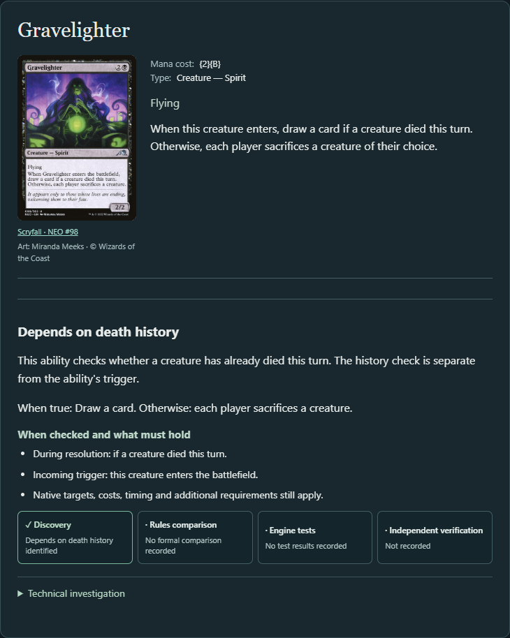
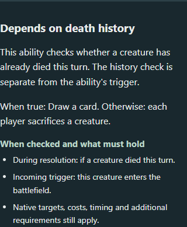

# Outcome-neutral conditional discovery

Launch `.\scripts\explorer.ps1` and open the local address it prints. In Discover, run **A creature died this turn** for **Judith, the Scourge Diva**, and select **Depends on death history**. Gravelighter shows the incoming battlefield-entry trigger, the resolution checkpoint, and the draw and sacrifice alternatives. Tragic Slip remains available in the same search.

1. **Shared evidence.** The native walker records the condition, checkpoint, action, true and false effect trees, and branch paths. It establishes whether the supported instructions differ and links them to the facts and event outcomes already emitted for that action and subtree. The record keeps prerequisites and incoming events. An objective separately checks whether the predicate fits its anchor and whether the branch context is understood.
2. **Reuse.** One record answers whether an action depends on a historical state, which branch contains an operation, and which existing facts describe its object and controller scope. The same Gravelighter action ID links the false branch to the sacrifice fact. A fact query can check compatibility with a nontoken creature you control on the battlefield, while the state query checks the history predicate.
3. **Gravelighter.** The creature entering triggers the ability. At resolution, a prior creature death selects drawing one card. With no prior death, each player sacrifices one creature they control if able. The sacrifice can cause a death, subject to the available creatures and zone-change rules. This happens after branch selection, so that death cannot change the earlier decision. The state result is MATCH.
4. **Different consequences.** The tests cover increased counters, a larger negative stat change, losing life as a controller, drawing fewer cards, and a true branch that suppresses a life loss. They retain polarity and recipients. The activation restriction on Skirsdag High Priest controls availability and its native action retains all tap costs. Denethor checks deaths under your control at triggering and at resolution.
5. **Other state conditions.** Scute Swarm's land entry triggers the ability, and six lands selects a self-copy instruction over making an Insect. The count witness is compatible at six and fails at five. The guarded event-to-copy outcome still carries UNKNOWN. A synthetic threshold with life loss and draw exercises the same machinery with two different operation types.
6. **Mechanical boundaries.** Grim Haruspex remains a direct death response. Tannuk retains a land-entry trigger and the history of its own ability resolutions. Execution-count interpretation remains unresolved. Hardened Scales modifies an impending placement through replacement, outside this bounded state and trigger interpretation. The candidate CLI returned `Card not found` for Grave Pact. Its frozen source expectation and the opponent-sacrifice synthetic control remain separate evidence.
7. **Other assumptions.** Event response extraction projects draw and token creation, with separate structural filters for incoming event, branch, amount and recipient. Other outcomes such as life loss and opposing sacrifice have no general event-response projection. The legacy death-enhanced-removal path still compares magnitudes for same-target removal and can leave unlike operations unresolved. Input supply uses source identity, zone, controller and actual self-return. Replacement support remains bounded. [Event outcomes](EVENT_OUTCOME_DISCOVERY.md) · [Creature input discovery](CREATURE_INPUT_DISCOVERY.md)
8. **Admission.** Gravelighter's false branch is mechanically compatible with producing a qualifying death. It remains a policy NO_MATCH in **My nontoken creatures die**. Tragic Slip and Tragic Banshee retain their historical removal admissions. Card type alone is insufficient, while proposed ordinary-capability and generic-interaction exclusions remain under investigation. [Admission study](OBJECTIVE_ADMISSION_PRINCIPLES.md) · [Selection and composition study](SELECTION_COMPOSITION.md)
9. **Controlled results.** See the table and [comparison receipt](evidence/conditional-causal-comparison.json).
10. **Adversarial cases.** Equal instructions and equivalent controller references provide no branch difference. Sibling effects cannot supply a difference to the gate. Negated and compound predicates can remain unresolved against the anchor even when the recorded alternatives are distinct. Nested reachability and arbitrary dynamic or unsupported payloads remain bounded.
11. **Evidence scope.** The [new frozen controls](../src/test/resources/regression/conditional-causal-sources.json) supplement [PR #50's source cohort](../src/test/resources/regression/state-dependency-sources.json). The fixture tests establish native structure. The Gravelighter scenarios test two actual positions, and the screenshots show the running application. Independent qualification has its own source- and revision-bound approval process.
12. **Next decision.** Extend the existing event-outcome projection to supported sacrifice operations with explicit player binding. A focused follow-up can test whether a direct death trigger with an interactive or controller-cost outcome can reuse the same operation facts and preserve existing admission decisions.

## Controlled catalog results

Each value counts distinct cards / pathways. The comparisons use the same eligible cards within each commander.

| Commander | Eligible | MATCH before → after | UNKNOWN before → after | NO_MATCH before → after |
| --- | ---: | ---: | ---: | ---: |
| Judith, the Scourge Diva | 6,111 | 6 / 6 → 7 / 7 | 9 / 9 → 8 / 8 | 0 / 0 → 0 / 0 |
| Krenko, Mob Boss | 3,472 | 0 / 0 → 0 / 0 | 1 / 1 → 1 / 1 | 0 / 0 → 0 / 0 |
| Kenrith, the Returned King | 15,955 | 14 / 14 → 15 / 15 | 15 / 15 → 14 / 14 | 0 / 0 → 0 / 0 |

Gravelighter accounts for both transitions in the overlapping pools. Every prior match remains admitted, and the receipt lists the unresolved cards and branch paths. The NO_MATCH column counts evaluated pathways only. All nine legacy reports were byte-for-byte identical, including four objectives each for Judith and Krenko and the death objective for Kenrith. The state-report comparisons also verified equality of the eligible cards, facts, actions, event outcomes and unsupported records.

## Reproduction

- The live application base is `19229b06b5e4b91e99f261b6052a912568f2f285`. The retained PR #50 CLI reports have the same runtime sources as this base (`git diff cd642d9 19229b0 -- src/main` is empty). The engine revision is `bd26b756b8b4d347f19e92bc77ef020919ebfa48`.
- Legacy CLI reports came from `0a54c319ed0725e659cc5a3ebcf93908cf01fc91` and history reports from `8eb69bdf0595ed005bb8f54acc26465b77370589`. The latter preserves absent fields when decoding old history reports. The final presentation commit `01de7124b3628266397ed17fa3a04fc0eca21253` names the entering creature in the state explanation and checks that wording in the browser.
- Export `mtg-assistant discover --commander "<commander>" --objective <id> --json --output <file>` for all five objectives under Judith and Krenko, plus the death and history objectives under Kenrith. Use the filenames in the comparison receipt. Run `python scripts/compare-conditional-causal.py <retained-pr50-cli-directory> <candidate-cli-directory> docs/evidence/conditional-causal-comparison.json`. The optional `--history-after <directory>` selects history exports from the final historical-compatibility revision separately from the legacy reports.
- `pnpm install --frozen-lockfile` and `pnpm build` passed. `pnpm exec playwright test state-dependency.spec.ts event-outcomes.spec.ts creature-inputs.spec.ts` passed all four tests against the final presentation build on a separate local port. The build metadata includes `+dirty` for pending report and documentation files. The screenshots use the normal Discover route and the frozen Oracle snapshot for artwork identity. The browser suite tested the two history controls, direct death responses and creature input supply.
- The serial `bash scripts/verify.sh full` gate passed at `01de7124b3628266397ed17fa3a04fc0eca21253`. Gradle recorded 678 tests with zero failures, errors or skips, including two fresh Gravelighter execution positions and seven state-dependency tests. The distribution build and current catalog checks passed. The six final catalog snapshots also matched the live-baseline files byte for byte. The gate still reports differences against its older historical fingerprints, as it did in PR #50.
- The first compile caught an SDK property smart-cast error. A subsequent parallel verification run lost build outputs in the shared Gradle engine checkout and reported class-loading errors. A clean isolated application build resolved those errors in the serial run.
