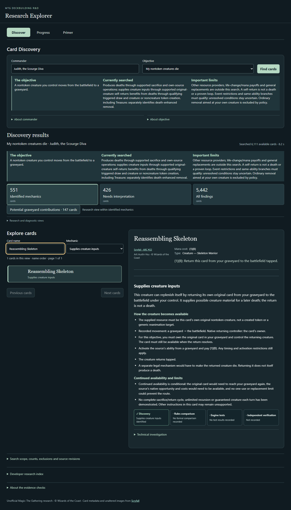
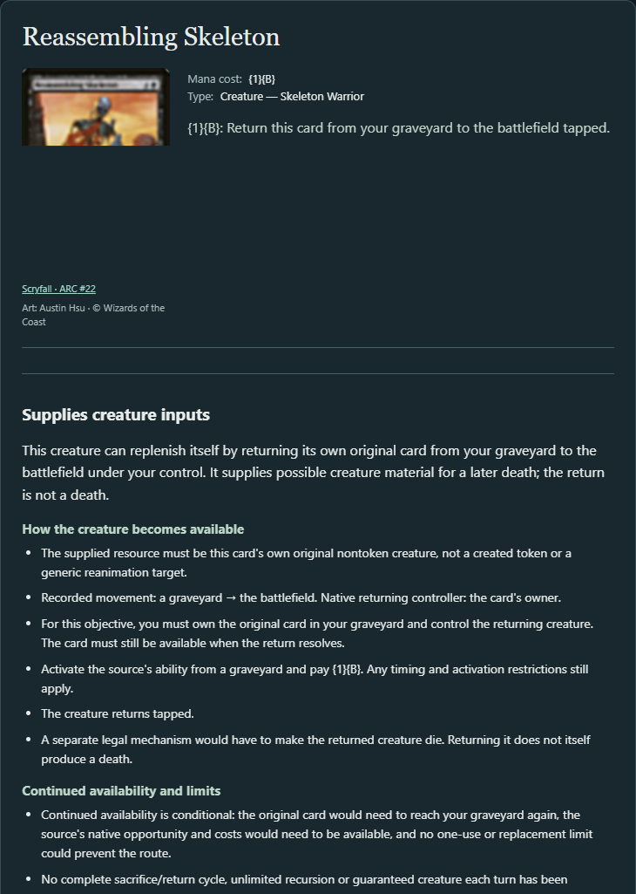
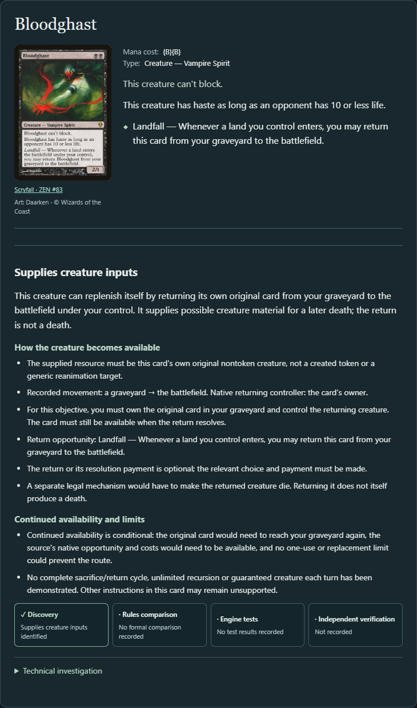
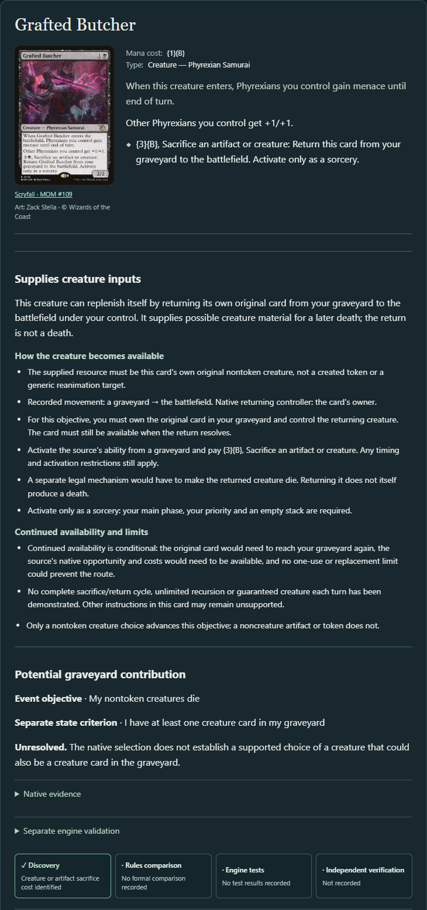
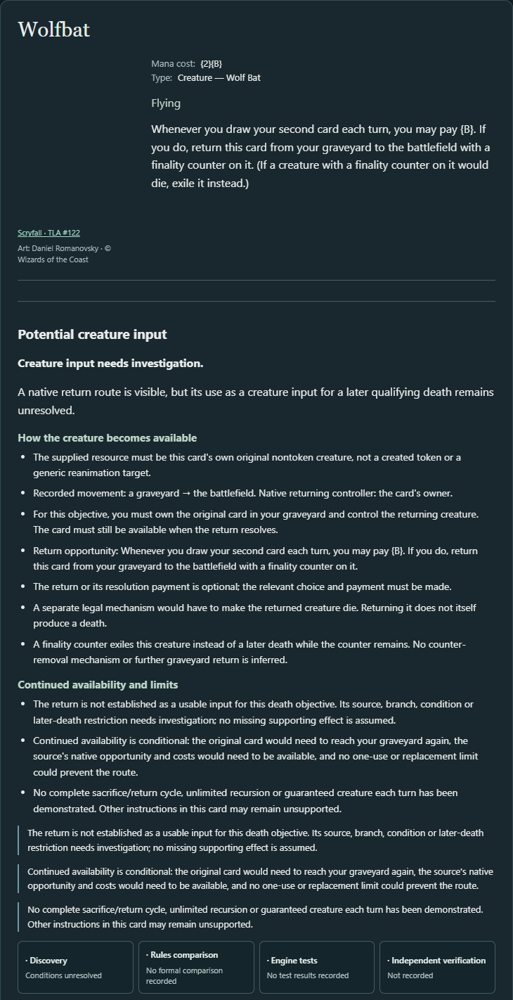
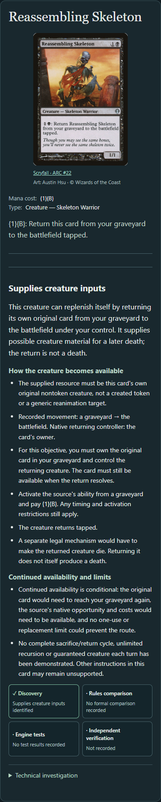

# Creature input replenishment — Product Studio delivery

This increment adds **Supplies creature inputs** to **My nontoken creatures die**. Reassembling Skeleton and Bloodghast now appear through their native self-return mechanics. Ordinary creatures and generic reanimation do not acquire this contribution. Returning a creature does not cause a death, and discovering a return route does not establish a repeatable sacrifice cycle.

## Capability and mechanical boundaries

The existing `PathwayExtractor` now emits an additive `SelfReturnLink` joining an existing movement fact to its originating card, face, action, ability/branch, source context and restrictions. No second walker, Oracle interpreter, card-name exception or engine modification was introduced. Existing movement facts alone did not establish that the moved original creature was the source of the return ability, or that the source could use that ability from its actual zone.

The reusable `originalCreatureSelfReturns` query checks explicit original-source binding, original creature-card status, our graveyard → battlefield under our control, source availability and supported causal branch. The death objective consumes that relationship through `selfReplenishment`, adding a check for unresolved later-death barriers. The generic reanimation objective retains its existing acceptance rules. A generic reanimation target does not become the spell's own creature resource.

Native action/fact IDs, paths, movement, owner/controller, active zones, costs, optional gates, timing, requirements and limits remain inspectable. Explicit self-binding is required; ambiguous bindings remain UNKNOWN. Normal creature layouts are supported; uncertain multi-face/type-changing cases remain UNKNOWN. Unsupported conditions, delayed/modal branches and opaque source replacements do not become matches. A narrow source-cost check protects source availability; it is not a universal cost-payment or game-state solver. Mana/resource availability remains a prerequisite.

The new interpretation preserves the legacy fact records. Where old single-zone fallback cannot settle a new source transition, only the new query uses an explicitly disclosed uncertain view. Missing interpretation does not become a definitive mechanical negative. No supplied creature is automatically paired with a sacrifice outlet.

## Source requirements and discriminating cases

The [17-case source expectations](../src/test/resources/regression/self-replenishment-expectations.json) were frozen in `b619ab9` before production changes. They retain physical source/snapshot identities, Oracle text, source hashes, native paths and normalized native-source hashes. Existing sacrifice-boundary and source-zone evidence remains intact. The unchanged baseline fails all three new API admission assertions for Skeleton, Bloodghast and Bladewing's Thrall; the implementation passes them.

| Case | Current input contribution | Preserved distinction |
| --- | --- | --- |
| Reassembling Skeleton | MATCH | Graveyard activation, {1}{B}, tapped entry; another death requires a separate mechanism |
| Bloodghast | MATCH | Own land entry, source in graveyard, optional return of original card |
| Bladewing's Thrall | MATCH | Graveyard-active qualifying Dragon-entry trigger |
| Forsaken Miner | MATCH | Crime condition, optional mana payment; no complete cycle inferred |
| Phoenix Chick | MATCH | Qualifying attack and payment requirements |
| Haunted Dead | MATCH | Graveyard activation and discard resources; the original creature is distinct from its token output |
| Flamewake Phoenix; Persistent Marshstalker | UNKNOWN | Additional intervening conditions not resolved by the bounded return query |
| Wolfbat | UNKNOWN for this objective | Return route itself MATCH; finality prevents a later qualifying death while the counter remains |
| Tymaret, the Murder King; Squee, Goblin Nabob | NO_MATCH | Return to hand is not direct battlefield replenishment |
| Reanimate; Phyrexian Delver | NO_MATCH | Generic reanimation does not bind the returned creature to the originating physical creature card |
| Walking Corpse; Heat Shimmer | No qualifying return link | Ordinary material / token copy; absence of a link is not an emitted mechanical NO_MATCH |
| Tenacious Dead; Mimic Vat | Missing native definition | Availability gap, not a mechanical rejection |

Three [supplemental source controls](../src/test/resources/regression/self-replenishment-catalog-controls.json) were selected from the first uncurated catalog output: Grafted Butcher, Falkenrath Forebear and Retrofitted Transmogrant. These are post-catalog validation, not a predeclared blind hold-out. Grafted Butcher has separately supported death-cost and supplier pathways in the same native action; the cost consumes another battlefield resource while the source is in its graveyard. This establishes no self-paying loop. Retrofitted Transmogrant's +1/+1 counters are not finality counters.

Falkenrath Forebear's old sacrifice-cost result remains UNKNOWN: its source specifies Blood tokens, while the retained native type/filter interpretation does not settle the old nontoken-creature-cost question. The new self-return match does not certify the entire card or resolve that concern.

The [fresh identity bindings](evidence/creature-input-source-bindings.json) associate 18 available definitions with the expected Oracle identities; two are missing. Physical retained printings, native printing fields and representative snapshot printings remain distinct. Identity association is not mechanical/source-fidelity certification. Snapshot SHA-256: `081a50ef82c767523f955e914153cf988ff045a72e3765b6aa2382567f9eb53a`; native identity digest: `af45623ce691b4d3f129121b0ce73e7224adf941295be45d414d0906f3ad0adb`.

## Discovery gains and controlled preservation

Eight complete headless runs compare exactly the same eligible populations against merged main and the candidate. Units below are **distinct MATCH cards / MATCH pathways**, across all contributions to that objective. Overlapping categories must not be summed as distinct cards.

| Context / eligible cards | Objective | Before | After |
| --- | --- | --- | --- |
| Judith / 6,111 | My nontoken creatures die | 538 / 552 | **551 / 566** |
| Judith / 6,111 | Reanimate own creatures | 104 / 106 | 104 / 106 |
| Judith / 6,111 | Create creature tokens | 346 / 363 | 346 / 363 |
| Judith / 6,111 | Stock own graveyard | 508 / 535 | 508 / 535 |
| Krenko / 3,472 | My nontoken creatures die | 218 / 223 | **220 / 225** |
| Krenko / 3,472 | Reanimate own creatures | 18 / 19 | 18 / 19 |
| Krenko / 3,472 | Create creature tokens | 182 / 190 | 182 / 190 |
| Krenko / 3,472 | Stock own graveyard | 230 / 239 | 230 / 239 |

Judith gains **14 supplier cards / 14 pathways**: Bladewing's Thrall, Bloodghast, Falkenrath Forebear, Forsaken Miner, Ghoulsteed, Grafted Butcher, Haunted Dead, Persistent Specimen, Phoenix Chick, Razorlash Transmogrant, Reassembling Skeleton, Retrofitted Transmogrant, Tunnel Rats and Warcry Phoenix. Thirteen are newly matched death-objective cards; Grafted Butcher was already matched through its sacrifice cost. Krenko gains Phoenix Chick and Warcry Phoenix: two newly matched cards / two pathways.

The new supplier checks additionally expose **56 UNKNOWN pathways on 56 Judith cards**, and **177 NO_MATCH pathways on 169 cards**; Krenko adds **16 UNKNOWN pathways on 16 cards** and **42 NO_MATCH pathways on 41 cards**. These are new checks, not changed historical decisions. Distinct cards can occur in multiple verdict sets. Wolfbat is among the explicit UNKNOWN checks; incomplete return associations are not silently dropped.

The [controlled comparison](evidence/creature-input-comparison.json) includes all new card/path checks, counts and before/after report hashes. Every old result row, including decisions and prerequisites, is exactly equal after removing the new supplier rows. All eight pairs retain exactly equal mechanical inputs, eligibility, actions, facts, unsupported structures, structural support, translation assurance, conditional arrivals and event-to-outcome records. There are no lost matches or unexpected old-path changes. Unsupported record totals do not change. The new root `selfReturns` records are additive in all four reports; unrelated objectives do not use them for admission.

The existing audit-diff command still reports duplicate pathway bases: Faerie Fencing (Judith death), Sorceress's Schemes and Bumi Bash (both reanimation contexts), and Sazacap's Brew (both stock contexts). Its signature/ordinal warning is retained in [diff caveats](evidence/creature-input-diff-caveats.json). Exact ordered legacy-row comparison supplements that tooling rather than normalizing away the ambiguity. No identity/eligibility population differences were observed. Historical benchmark fingerprints differ as expected with the additive results; current catalog acceptance passes and frozen benchmarks were not rewritten. These observations do not establish catalog-wide precision or recall.

## Normal Discover experience

The existing Mechanic filter now exposes **Supplies creature inputs**, alongside Produces deaths, Benefits from deaths and Death-enhanced removal. Existing grouping and selected-ability inspection remain the navigation. The supplier section explains the original resource, actual movement, trigger/activation, costs, optionality, timing and continued-availability limits. UNKNOWN details explain what prevents a supported death-input claim.

Actual running-application captures, runtime `7fdee05`, desktop and 390-pixel viewport:

The browser exercise checked Skeleton and Bloodghast, Haunted Dead's resource cost, Grafted Butcher's overlapping contribution and sorcery timing, Walking Corpse / Reanimate / Tymaret exclusions, Wolfbat's UNKNOWN/finality explanation, and mobile layout without horizontal overflow. CLI/headless output retains provenance and the new relationship evidence.

## Verification and exact revisions

- Baseline merged main: `eeea26f43c456f29189a976789fa0ad5293e19bb` (PR #46 merged).
- Final runtime implementation: `7fdee05defb71c4b73926248983819ef6ba13d8b`; later `6feaafa` changes only the overlap browser assertion. Subsequent delivery edits are documentation/evidence only.
- Clean maintained engine, unchanged throughout: `bd26b756b8b4d347f19e92bc77ef020919ebfa48`, live `origin/app-stable` verified. No engine PR or SDK changes.
- JDK 21.0.12.1; full candidate gate: `bash scripts/verify.sh full` — **662 JVM tests, zero failures/errors/skips**, installDist success, five catalog-comparison Python tests passed, current catalog gate passed. Existing historical fingerprints report false because these additive discoveries are absent from the frozen history.
- Frontend: `pnpm build` passed; final browser command from `web`, `EXPLORER_URL=http://127.0.0.1:8794 pnpm test` — **35 passed** against the actual Kotlin application, not a fixture server.
- Focused suites: `SelfReplenishmentAdmissionTest`, `SelfReplenishmentExtractionTest`, `SelfReplenishmentDiscoveryTest`, `SelfReplenishmentExplanationTest`, `SelfReturnScenarioTest`, plus preservation assertions in existing suites. Synthetic adversarial cases cover owner/controller/zone mismatch, noncreature/ambiguous face, original binding, cost-consuming source, explicit versus unresolved source transitions, return-to-hand/copy/generic movement, branch/action separation, unsupported gates, one-use/turn restrictions, finality and unrelated/nonfinality counters. Held-out synthetic forms challenge associations beyond the primary real-card cohort.
- Three actual native scenarios passed: Skeleton requires the full {1}{B} payment and returns the same physical entity with a new battlefield object generation tapped; Bloodghast returns that original entity through an own-land event and accepted optional choice; Wolfbat returns with finality, then native removal moves it to exile instead of producing a death. These are bounded scenarios, not whole-card or full-cycle qualification.
- Before/after command for each of Judith and Krenko and all four objective IDs: `java -Xmx1g -XX:ActiveProcessorCount=4 -cp 'build/install/mtg-assistant/lib/*' dev.mtg.assistant.MainKt discover --commander '<commander>' --objective '<id>' --json --output '<report.json>'`. Existing `audit diff` ran on all eight pairs; exact-field/ordered-row comparison is recorded separately. Fresh identity and identity-coverage commands use the retained snapshot above.
- The three admission tests also ran unchanged against unmodified main: **three expected assertion failures**, demonstrating omission before implementation. Earlier authoring failures (Kotlin cross-module smart cast, unsupported test layout constant, and ObjectRef/entity-ID assertion shape) were corrected before the passing gates; an own UTF-8 editing-script failure was restored and reapplied. A slow research scan was replaced with `rg`. No unresolved test failure remains.

Raw before/after reports, XML results, baseline failures, source records, comparison scripts, browser receipts and logs remain in ignored `generated/creature-inputs/`. Compact reviewed evidence is committed above. Historical source evidence, qualification records, benchmark files and payment screenshots retain their original contents. Fresh browser executions were saved separately before restoring historical screenshot bytes. The existing stable service on port 8787 was not replaced.

For local review from a candidate checkout with dependencies installed: `./scripts/explorer.ps1 -Port 8794 -OracleSnapshot '../mtg-deckbuilding-assistant/generated/oracle/oracle-cards-20261026210159.jsonl.gz'`. Choose Judith → My nontoken creatures die → Discover → Mechanic: Supplies creature inputs; select Skeleton, Bloodghast and Grafted Butcher. Clear the filter and include unresolved results to inspect Wolfbat. See the normal README launch for a primary checkout.

## Limits and next consequential decision

This implements bounded intrinsic original-creature return, not generic resource-provider classification, an objective builder, layered objectives, sacrifice-outlet pairing, loop proof or strategic scoring. Unsupported conditions and one-use/replacement consequences remain visible. No independent qualification or exhaustive full-cycle gameplay verification was performed; source identity does not remove existing fidelity concerns. Additional restrictions may remain unsupported even when a particular route is structurally supported.

The next substantial bounded decision is whether to interpret **additional native intervening conditions for source-bound return routes**, using Flamewake Phoenix and Persistent Marshstalker as source-first controls. That could resolve currently explicit UNKNOWN cases without broadening into multi-card recursion. This extension has not begun. This delivery is for review in one application PR; it is not merged and does not assert Product Studio acceptance.
