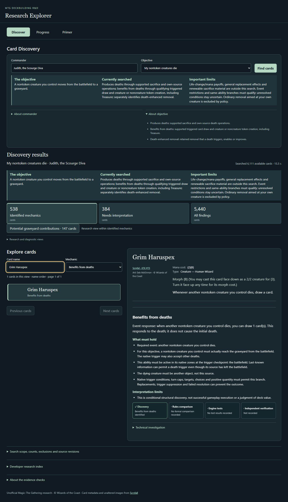
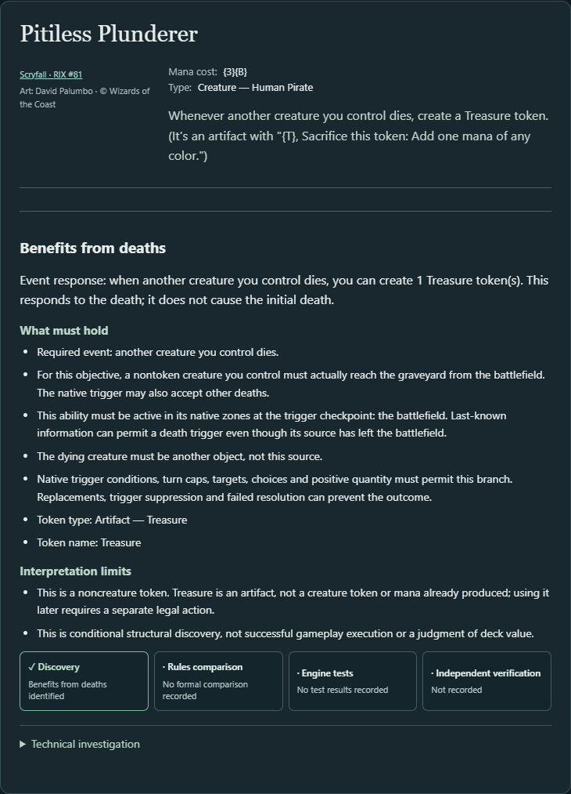
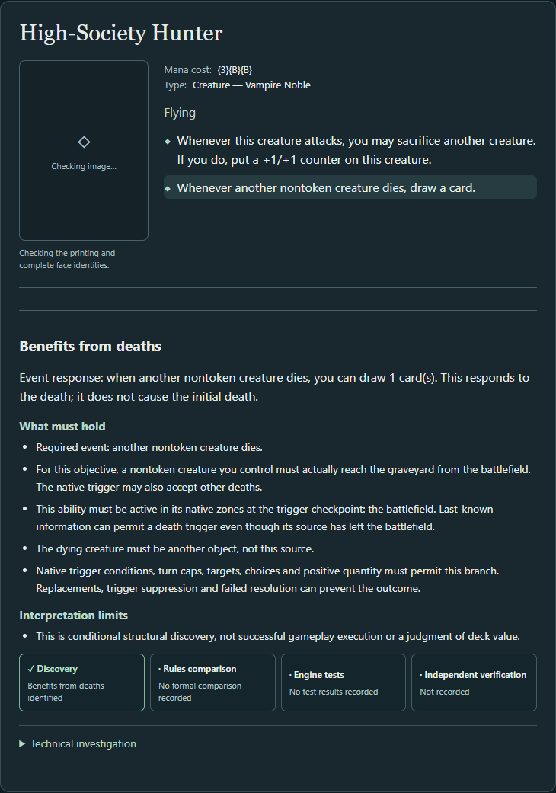
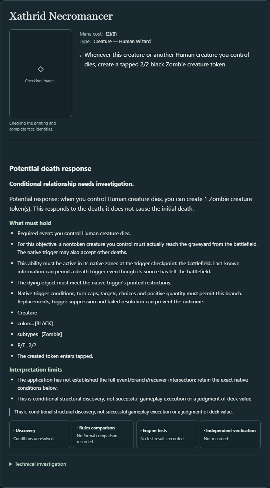

# Event-anchored discovery: Product Studio report

2026-11-10 · Application implementation, author verification and review handoff. **Not merged or independently qualified.** Review: [application PR #46](https://github.com/jasullivan5/mtg-deckbuilding-assistant/pull/46).

## 1. Mechanical implementation

The existing **My nontoken creatures die** objective now discovers supported death-triggered card draw and creature/noncreature token creation. It distinguishes **Produces deaths**, **Benefits from deaths**, and the retained **Death-enhanced removal** contribution through the existing Mechanic filter and selected-ability inspection.

`PathwayExtractor` carries a native trigger context into its existing effect walk. Shared `EventOutcome` records join **incoming event → native ability/branch → draw or token output**, preserving the native event, binding, source face/active zones, action ID, effect path, quantities, receiver, optionality, conditions, limits and exact native nodes. Token outputs reference the existing token facts; draw interpretation is additive. Separate branch guards retain unsupported conditional, modal, payment, iteration, reflexive and deferred contexts as uncertain.

`EventOutcomes.kt` intersects a supported incoming zone event with our nontoken creature's battlefield-to-graveyard event, using the existing correlated fact/filter evaluator. A broader token-inclusive death trigger can qualify; opponent-only and token-only triggers cannot. Owner and controller remain independent. Same-card outputs do not borrow another ability's trigger. Recognized positive output quantity and a receiver that can include us are separate checks.

This interface describes the supported **TRIGGERED_ABILITY** subset. It neither defines all event beneficiaries as triggers nor implements general replacements, a universal effect vocabulary, a dependency graph or an objective language. The engine and completed payment work are unchanged.

## 2. Discovery gains

| Context | New supported response paths / cards | Newly matched cards | New UNKNOWN paths / cards | New NO_MATCH paths |
| --- | --- | --- | --- | --- |
| Judith, the Scourge Diva | 53 / 52 | 51 | 42 / 42 | 3 |
| Krenko, Mob Boss | 15 / 15 | 15 | 17 / 17 | 1 |

These are overlapping card sets, not exclusive classifications. Wurmcoil Larva has two supported token-output paths. High-Society Hunter was already accepted through its **attack-triggered optional sacrifice** and gains a separate death-triggered draw contribution. Its two abilities remain independently selectable. Liliana, Dreadhorde General gains draw without promoting its policy-excluded symmetrical sacrifice ability.

Grim Haruspex, Pitiless Plunderer and Doomed Dissenter were omitted on the unmodified baseline: three identical API admission assertions failed there and pass with the implementation. Additional predeclared validation cards include Midnight Reaper, Harvester of Souls and Ogre Slumlord. The complete new-path inventory, retained/new card counts and raw-report hashes are in [the compact evidence record](evidence/event-outcome-comparison.json).

## 3. Generalization beyond deaths

The same shared walk extracts Garruk's Packleader's creature-entry → optional draw relationship with its native power restriction intact. It also extracts Scute Swarm's land-entry → conditional token branches, which stay uncertain and never become death responses. Hanged Executioner's actual entry → creature-token relationship passes the reusable battlefield-entry event query while failing the death query; its separate activated removal cannot supply a death trigger. A synthetic entry → draw control also passes the shared event intersection.

These tests establish reusable extraction and a supported nondeath query, not a general power/state solver or new Discover objective.

## 4. Correctness and source controls

Expectations for thirteen physical-source cards and adversarial native controls were frozen in [the consumed fixture](../src/test/resources/regression/event-outcomes-expectations.json), commit `a6e4f9f`, before production extraction changed. The seven required examples were supplemented by Midnight Reaper, Harvester of Souls, Ogre Slumlord, Xathrid Necromancer, Liliana and Hanged Executioner as predeclared validation controls beyond the demonstration set. This was author-led verification, not an independent blind evaluation.

| Case | Observed distinction |
| --- | --- |
| Grim Haruspex | Another nontoken creature you control dies → draw; MATCH |
| Pitiless Plunderer | Another creature you control dies → Treasure; MATCH, including qualifying nontoken deaths |
| Doomed Dissenter | This creature dies → Zombie; MATCH; it does not initiate its own death |
| Viscera Seer | Sacrifice cost remains death production; scry is not a death-triggered outcome |
| Tragic Slip | Prior-death history remains enhanced removal; no new triggered response |
| Midnight Reaper | Draw response MATCH; the separate player-damage rejection remains |
| Harvester / Ogre | Another nontoken death, possibly ours, → optional draw / Rat; MATCH |
| Xathrid Necromancer | Human subtype intersection stays UNKNOWN; tapped Zombie details remain inspectable |
| Opponent-only / token-only controls | NO_MATCH; broader token-inclusive triggers still qualify |
| Attached/rebound sources; noncreature SELF; extra conditions | UNKNOWN rather than invented matches |
| Conditional alternatives, zero quantity, opposing receivers, unrelated abilities | Separate paths/uncertainty or NO_MATCH as appropriate |

Catalog negatives include opponent-only death conditions on Massacre Girl, Known Killer and Moonstone Eulogist, and Thought-Knot Seer's opponent draw receiver. No production card-name exceptions were added.

The retained Oracle bulk snapshot is `oracle-cards-20261026210159.jsonl.gz`, SHA-256 `081a50ef82c767523f955e914153cf988ff045a72e3765b6aa2382567f9eb53a`. Its representative printing can differ from the native printing. A fresh existing identity-enrichment run on engine `bd26b756` associates all thirteen with the expected canonical Oracle IDs as CONFIDENT, using `PHYSICAL_NAME_LAYOUT_COST_TYPES`. The evidence retains both printing identities and the method; this is not an exact-printing equality claim, a metadata overlay or mechanical certification. Earlier physical-source captures, PR #45 research and qualification records remain unchanged.

## 5. Preservation across the full eligible populations

Exactly the same ordered eligible card lists were used before and after; there was no conventional-search filter. The source baseline is application `bf7d97bc4cdea6501c90646d945add5dd9d261bd` (merged PR #45), with the same clean maintained engine revision used throughout.

| Context | Objective | Eligible cards | MATCH cards before → after | MATCH paths before → after | UNKNOWN paths before → after | Unsupported records before → after |
| --- | --- | --- | --- | --- | --- | --- |
| Judith | Nontoken deaths | 6,111 | 487 → 538 | 499 → 552 | 410 → 452 | 8,702 → 8,702 |
| Judith | Reanimate creatures | 6,111 | 104 → 104 | 106 → 106 | 93 → 93 | 8,318 → 8,318 |
| Judith | Creature tokens | 6,111 | 346 → 346 | 363 → 363 | 55 → 55 | 8,702 → 8,702 |
| Judith | Stock graveyard | 6,111 | 508 → 508 | 535 → 535 | 576 → 576 | 8,537 → 8,537 |
| Krenko | Nontoken deaths | 3,472 | 203 → 218 | 208 → 223 | 190 → 207 | 4,861 → 4,861 |
| Krenko | Reanimate creatures | 3,472 | 18 → 18 | 19 → 19 | 35 → 35 | 4,760 → 4,760 |
| Krenko | Creature tokens | 3,472 | 182 → 182 | 190 → 190 | 33 → 33 | 4,861 → 4,861 |
| Krenko | Stock graveyard | 3,472 | 230 → 230 | 239 → 239 | 252 → 252 | 4,835 → 4,835 |

Every preexisting result is exactly equal, including verdicts, decisions, prerequisites and native evidence. Actions, facts, eligibility, unsupported/structural-support records, translation assurance and conditional graveyard arrivals are also exactly equal in each corresponding report. No matched cards were lost. The added shared relationship metadata is exported by all four objectives, but the other three objectives admit no new cards or paths. Treasure remains excluded as a creature-token result.

Retained death production: Judith **474 paths / 462 cards**, Krenko **200 / 195**. Retained enhanced removal: Judith **25 / 25**, Krenko **8 / 8**. New UNKNOWNs are additional response assessments, not reclassifications of legacy results. Unsupported-record counts do not decrease; absent interpreted outputs are not converted into mechanical negatives.

The existing diff tool reports stable duplicate pathway bases for **Faerie Fencing**, **Sorceress's Schemes**, **Bumi Bash**, and **Sazacap's Brew**. Those ambiguities remain in the evidence; no legacy path was silently overwritten or normalized away. Exact ordered-list comparisons independently establish preservation. The catalog gate's historical full-report fingerprints are **different**, as expected for additive relationships; current benchmarks pass with zero confirmed mismatches. No frozen historical baseline was rewritten.

All eight exports were regenerated from the final presentation build and are **byte-identical** to the full-gate build's exports.

## 6. Normal Discover experience

Select Judith and **My nontoken creatures die**, choose **Benefits from deaths** in the existing Mechanic filter, then inspect Haruspex, Plunderer or Dissenter. The selected ability states the required event, possible output, source/other-object restrictions, conditions and uncertainty. Self-death explanations explicitly allow last-known information and do not require the source to remain on the battlefield for resolution. Treasure is explained as a noncreature artifact token, not mana already produced. No new navigation or role taxonomy is required.









The bundle also includes Hunter's production ability, Dissenter and the 390-pixel mobile capture. These are actual running-application screenshots. Card-image checking is independent; some captures show a pending/fallback image state and do not certify artwork or printing fidelity.

## 7. Verification and actual revisions

| Evidence | Revision / result |
| --- | --- |
| Baseline application | `bf7d97bc4cdea6501c90646d945add5dd9d261bd` |
| Full gate / complete browser suite | `6fdeedec43885dd21f6bb4a6e756d0bbb100742a` |
| Final application, focused tests, expanded flow and final exports | `a591bf3103d2ac0cb525d087a9d7a6b6d2a0bc89` |
| Maintained engine, unchanged `app-stable` | `bd26b756b8b4d347f19e92bc77ef020919ebfa48` |
| Full application suite | **615 passed**, zero failures/errors |
| Final focused relationship/explanation tests | **30 passed**, zero failures/errors |
| Complete Edge/Playwright browser suite | **34 passed** |
| Final expanded Discover flow after presentation refinement | **1 passed**, including overlap, UNKNOWN and 390-pixel checks |
| Full catalog gate | **Passed**; six established benchmark reports, zero confirmed mismatches; comparison-script tests pass |
| Controlled population reports / existing diffs | Eight before/after pairs; all comparable; zero legacy changes or lost matches |

Commands used (JDK 21, required PATH, isolated `mtg-event-validation` checkout):

```powershell
.\dev.ps1 test --tests '*EventOutcome*Test'
# Repository full gate, through Git Bash:
bash scripts/verify.sh full
# Inside web/, targeting the real Kotlin application:
$env:EXPLORER_URL='http://127.0.0.1:8793'
$env:EXPLORER_BROWSER_CHANNEL='msedge'
pnpm test
pnpm exec playwright test tests/event-outcomes.spec.ts
```

CLI reports used `discover --commander <Judith or Krenko> --objective <each of the four IDs> --json --output <file>`, followed by `audit diff --before <file> --after <file> --json --output <file>`. Source identity was checked with `audit catalog-coverage --global --oracle-cards <retained snapshot> --enrichment-output <file> --json --output <file>`. Exact report hashes, the eight final-export equivalence checks and identity bindings are retained in the compact evidence record. Full raw reports, XMLs, browser results, commands and failure logs remain under ignored `generated/event-outcomes/`.

Earlier failures were retained and resolved: command/PATH and synthetic-fixture compilation errors; an incorrect new assumption that Liliana's symmetrical sacrifice was already accepted; and stale presentation expectations about omitted responses or Agent of Shauku's unresolved production. The full-suite attempts recorded 611 tests with 3 failures, 611 with 1, and 614 with 1 before the final 615/0 run. The assertion corrections preserve the legacy decisions. No test failures remain.

The final commit after the full gate changes only explanation formatting and associated tests/browser evidence. The 30 focused tests and expanded browser flow were rerun; the full suite was not repeated for that presentation-only refinement. All final report bytes were checked unchanged. The full-gate test configuration initially saw untracked frontend logs; they were preserved in ignored evidence before installation. Served builds and final exports use the clean recorded revisions above. All fourteen historical payment screenshots overwritten by existing browser tests were restored byte-for-byte, with fresh captures retained separately. The existing port-8787 service was untouched.

To relaunch the isolated review build from its checkout:

```powershell
.\scripts\explorer.ps1 -Port 8793 -OracleSnapshot '..\mtg-deckbuilding-assistant\generated\oracle\oracle-cards-20261026210159.jsonl.gz'
```

## 8. Limits and unexecuted claims

This is structural conditional possibility, not observed successful gameplay, repeat-frequency prediction, strategic value or whole-card certification. No independent qualification or exhaustive catalog-wide source/precision/recall evaluation was performed. The broader catalog was compared for consequences; the agreement of thirteen selected cards is not offered as catalog recall. New individual trigger gameplay scenarios, other browser engines and exhaustive accessibility checks were not run.

Subtype/complex filter intersections, attachments/rebound controllers, multi/non-battlefield active zones, extra trigger conditions, batch-death forms and unsupported conditional/deferred causal branches can remain UNKNOWN. General replacement effects such as Hardened Scales, other payoff kinds, renewable inputs such as Skeleton/Bloodghast, objective construction/composition and strategic evaluation remain outside this increment. Source availability, actual zones, replacements, legal resources/choices, quantities, caps and resolution still matter.

The Primer and living documents now describe focused **event, state or modification** anchors as a working hypothesis with overlapping directional contributions. Game elements describe the anchor, requirements and consequences. This is not a universal schema or proof that every deckbuilding goal has one anchor.

## 9. Next consequential decision

A small follow-up would be source-bound **subtype-restricted event intersections**, starting with Xathrid Necromancer and related Human/Zombie filters. It could reduce a visible class of UNKNOWN responses while reusing the new relationship layer. Product Studio should choose whether that gain is more useful than a separate renewable-input increment. Neither extension has begun.
