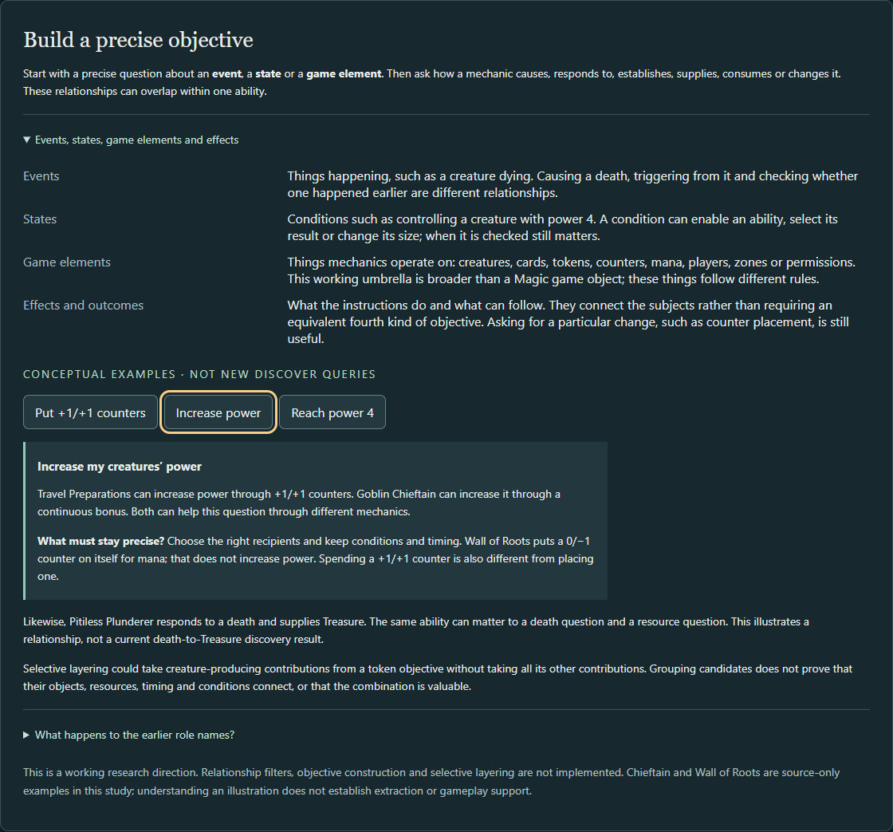

# Objective building blocks: bounded validation

## Criteria fixed before new held-out inspection

Application baseline `467a349` (merged PR #44); clean maintained engine `bd26b756b8` (merged PR #7). This increment inspects existing mechanics and extraction without changing either. The earlier [four-/five-role study](CONTRIBUTION_VALIDATION.md), including its original held-out Piledriver/Slip observations and state-access follow-up, is reused as exposed historical evidence, not reclassified as a new blind experiment.

The unit is one ability/branch and its relationship to a stated objective, not a permanent card role. Describe: initiating action/event; qualifying objects, players and zones; conditions and their evaluation times; operation, inputs/consumption and output; quantities/duration; uncertainty. Then compare how four/five roles, six roles, and subjects plus directional relationships explain the same record. Labels do not supply missing causal bindings.

Working descriptions: an **event** is an occurrence; a **state** is a predicate at a checkpoint or continuously; **game elements** are a provisional umbrella for mechanically different objects/resources/players/characteristics/permissions/zones; **effects/outcomes** describe operations and consequences connecting those subjects. Preserve cause, response, history-check, establish, depend-on, supply, consume and modify as potentially overlapping relationships. Do not require a numerical role taxonomy. Requirements and scaling may share an objective-level question while retaining different native timing and quantities.

Candidate criteria (research questions only):

1. **Put +1/+1 counters on my creatures:** identify actual placement of that counter type on a creature I control at placement. Separate direct placement from modifying somebody else's placement event, starting with counters, consuming counters, or depending on their presence. Ordinary bonuses and other counter types are negative controls.
2. **Increase my creatures' power:** identify a potential positive change to the same recipient's power, through counters or a continuous/temporary modifier. Retain recipient/control, amount and timing; distinguish direct change from conditional modification of another change. Supplying a body or granting an unrelated ability alone is insufficient. This is structural potential, not a net-power guarantee under every replacement or effect.
3. **Control a creature with power 4 or greater:** identify a route that could establish/maintain that predicate at a specified checkpoint, with starting power, recipients, resources and duration explicit. Creating/returning a sufficiently large creature can establish it without increasing an existing creature. Merely requiring the threshold is not establishing it. No context-free satisfiability verdict is inferred.

Success means preserving mechanically discriminating distinctions and identifying concrete reusable native information, not merely writing a plausible sentence. Compare selectivity, ambiguity/redundancy, reuse across objectives, selective layering, and additional specialized interpretation needed. Keep source expectations, native representation, shared extraction, actual discovery and unverified joins separate. A relationship grouping is not proof of an interaction or strategic value.

Development cases: Viscera Seer, Pitiless Plunderer, Grim Haruspex, Zulaport Cutthroat, Tragic Slip; Flamewake Phoenix, Scute Swarm, Cranial Plating, Goblin Chieftain; Travel Preparations, Hardened Scales, Walking Ballista and Wall of Roots. Reuse prior ordinary-body, Murder-policy, Coat-of-Arms controller and Piledriver-fidelity boundary observations without claiming new gameplay evidence.

Reserve **Doomed Dissenter**, **Garruk's Packleader**, and **Abzan Falconer** for evaluation after this criteria commit, without editing these criteria to fit them. They are purposive known-card controls, not blinded or statistically representative. Native availability is not assumed. A missing trustworthy definition remains source-only. No native executions, new objective implementations or qualifications are authorized here.

## Results and evidence boundary

Criteria were committed at `577306e60f94d8b7f46dc2033dd74e0e29228d65` before the three new held-out inspections. This was one author's purposive, source-led comparison, informed by earlier research, with no blinding, reader study, catalog-coverage estimate or independent qualification. It reuses the original study's results, including the Piledriver discrepancy hypothesis (still unexecuted), rather than rerunning or erasing them.

**Sixteen source cases, thirteen native definitions, twelve eligible discovery inputs are different populations.** Ten exact existing source snapshots were reused with their original bytes/hashes. Six additional original records were selected from the retained October 26 Oracle bulk snapshot, SHA-256 `081a50ef82c767523f955e914153cf988ff045a72e3765b6aa2382567f9eb53a`, not freshly retrieved Oracle data. Their exact printing/Oracle identities and original records are in [source captures](../src/test/resources/cards/objective-building-blocks-sources.json); the [observation/binding record](../src/test/resources/cards/objective-building-blocks-observations.json) links all sixteen sources, native paths/hashes, code bindings and actual query outcomes. Several new source printings differ from the native edition. All thirteen raw native Oracle-ID fields are null; selected names, native set/collector metadata and inspected instruction correspondence are recorded separately, not approved physical-identity mappings or whole-card fidelity judgments.

Read-only public-API inspection ran at application `577306e60f94d8b7f46dc2033dd74e0e29228d65` (only the criteria document differs from merged application `467a349c2158f6f4731e278faca6af3ffdba5fad`), clean engine `bd26b756b8b4d347f19e92bc77ef020919ebfa48`. It invoked existing `Catalog`, `PathwayExtractor.extract` and all four `discover` queries, not new predicates. Kenrith, the Returned King supplies a five-color control; the conventional name filter selects this cohort. The twelve ordered input names agree across queries. Chieftain, Plating and Wall of Roots have no runtime definition. Ballista has a definition and standalone extraction, but format MATCH / deck identity UNKNOWN excludes it before discovery. Neither exclusion is a mechanical NO_MATCH. No definitions, metadata, eligibility rules, discovery decisions or gameplay execution were changed.

### A. Events and outcomes

| Case | Source-established distinction | Actual native/extraction and existing discovery |
| --- | --- | --- |
| Viscera Seer | Sacrifice is an activation cost; actual battlefield-to-graveyard movement causes a death. Scry follows payment, not a death trigger. | Native cost yields SACRIFICE; death and graveyard queries MATCH. Scry has no general outcome fact. Legal resources and an actual death remain prerequisites. |
| Pitiless Plunderer | Another controlled creature, including a token, dies → trigger → Treasure. A later Treasure activation consumes that artifact for mana. | Trigger and CREATE_TOKEN fact are present. The creature-token query returns NO_MATCH for noncreature Treasure; the death query has no payoff result. That is not absent token extraction or a rules rejection. |
| Grim Haruspex | Another **nontoken** controlled creature dies → mandatory draw. Self/token deaths do not satisfy this trigger. | Native draw/trigger exist, but draw leaves are intentionally skipped and no draw fact/result is emitted. The separate Morph unsupported diagnostic is not a draw rejection. |
| Zulaport Cutthroat | Self or another controlled creature dies → each opponent loses life and you gain life. Life loss is not damage; life gain can support a different objective. | Native composite retains both outputs; LoseLife/GainLife leaves are unsupported by current extraction. No general death-payoff discovery. |
| Tragic Slip | Casting starts the spell; any earlier creature death, including opposing/token death, selects stronger reduction on resolution. It is not a death trigger. | Two TOUGHNESS_CHANGE facts; ordinary direct-removal checks NO_MATCH by policy, separate death-enhanced removal MATCH. Acceptance cannot be relabeled “triggered response.” |
| **Held-out Doomed Dissenter** | Its own death produces a 2/2 Zombie; it does not observe every other creature's death. | Native SELF death binding and CREATE_TOKEN; creature-token query MATCH, no death-payoff result. The existing token output is reusable, but a generic typed death-to-output join is missing. |

One event-conditioned effect can supply several potential outcome questions without changing the trigger: Cutthroat's death input and life outputs persist when the objective lens changes. The earlier study demonstrated that explanatory reuse, not an implemented life-gain query. Plunderer's Treasure can be an artifact-count input or a consumed mana resource; those uses compete. Grouping them with Plating does not prove timing, payment or a successful interaction.

### B. States and conditions

| Case | Source-established timing and direction | Actual support / limitation |
| --- | --- | --- |
| Flamewake Phoenix | Beginning of **your combat**, from graveyard; power 4+ under your control at triggering and again at resolution; optional {R}. Power 8 adds no larger return. | Native intervening-if and payment/return exist. Reanimation MATCH with prerequisites; this is not a generic power-state solver or an observed Chieftain/Phoenix interaction. |
| Scute Swarm | Controlled land entry triggers. Six controlled lands **on resolution** choose copy versus Insect. Six lands alone do not trigger it; ordinarily each resolution makes one token. | Native two branches, two CREATE_TOKEN facts; both creature-token outcomes UNKNOWN in this run. Native gate/copy constraints are retained, not generally solved. Source knowledge must not turn those into current MATCHes. |
| Cranial Plating | Equipped recipient gets a continuously varying power bonus based on artifacts **you control**. Attachment and recipient control are separate constraints. | Source-only in this engine. Prior study's artifact count and competing Treasure use remain illustrations, not extraction or execution evidence. |
| Goblin Chieftain | Fixed +1/+1 and haste for **other controlled Goblin creatures**, continuously. More recipients do not change the bonus per creature. | Source-only. A qualifying 3-power Goblin could reach 4 while the bonus applies; this is a conditional source-level explanation. |
| **Held-out Garruk's Packleader** | Another controlled creature must have power 3+ **as it enters** to trigger optional draw. No power recheck on resolution; a later boost cannot retroactively trigger it. Its separate 4/4 body could itself establish a power-4 state. | Native event filter/optional draw are present; no general draw fact/result. A blanket “state responder” or Phoenix-style double checkpoint would lose the actual mechanism. Body supply and triggered ability are separate contributions. |

Binary access, branch choice and continuous scaling support a common *does this state make the mechanic available or change its result?* question. They do not have interchangeable timing. The source-derived manual descriptions fit the frozen criteria; neither this exercise nor the previous roles establishes that users understand them better or that generic filtering already exists.

### C. Counter and power questions

Here “conditional” names a mechanically described route, not a solved game state. Recipient control, sufficient starting power, legal payment, duration and absence of prevention/replacement remain explicit. All three candidate queries are **unimplemented**.

| Mechanic | Put +1/+1 counters on my creatures | Increase my creatures' power | Establish control of power 4+ |
| --- | --- | --- | --- |
| Travel Preparations | Direct placement, choosing 1–2 legal own creatures from its broader target scope; choosing zero produces none | Counter-based increase | Conditional: e.g. an eligible 3-power recipient plus one counter |
| Chieftain's static bonus | No placement | Continuous increase to other controlled Goblins | Conditional on the right recipient, starting power and continuing bonus; source-only |
| Plating's static bonus | No placement | Continuous count-dependent increase | Requires attachment, controlled recipient, base power and enough controlled artifacts; source-only |
| Hardened Scales | Modifies another **one-or-more** placement, including entry counters; does not initiate it | Indirectly changes counter-based increase | Conditional on another placement and the resulting quantity; zero counters is not changed to one |
| Walking Ballista | Entry with X counters and its {4} grow activation place counters; removing one as a cost does not | Grow activation increases power; removal reduces its counter contribution. Entry's starting power versus an increase to an already-present creature needs an explicit observation window | Casting with sufficient X or later growth can establish the predicate under costs/conditions; no actual discovery result because identity is UNKNOWN |
| Wall of Roots | No: puts a 0/−1 counter on itself as a cost to add {G}, once each turn | No power increase from that counter; mana output is a separate resource | No intrinsic power-4 route from that ability. An unspecified external pump is not a direct contribution; source-only |
| **Held-out Abzan Falconer** | Outlast places one on itself; its separate flying ability places none | Outlast's counter contributes power; flying itself does not | Conditional growth from base power 2; two {W}, {T} outlast activations require legal sorcery timing and tap availability, not an assumed immediate pair |

Falconer is the strongest control against classifying a whole card as merely “uses counters.” The frozen **ability/branch** unit handles both the positive outlast operation and the negative static ability without revising the criteria. Native outlast and counter-based flying exist, but AddCounters and GrantKeywordByCounter are unsupported in the walker. Travel's AddCounters, Ballista's counter placement/removal and entry replacement, and Scales' placement replacement likewise lack reusable interpreted counter/power relationships; Ballista's separate DAMAGE fact does not establish those missing capabilities.

Two details need explicit objective choices rather than another role label. Entry with counters counts as placement ([CR 122.6](https://media.wizards.com/2026/downloads/MagicCompRules%2020261106.pdf)); it is not an enters-trigger, and “boost a creature already present” is narrower than “establish a larger creature.” The frozen first criterion fixes recipient control, not the identity of the placing player. A stricter “I place” question would need that actor binding. The [official Scales notes](https://media.wizards.com/2022/downloads/2X2_Release_Notes/EN_MTG2X2_Release%20Notes_20220418.pdf) corroborate entry-counter placement and quantity modification. No combined game position was executed.

## Comparison and recommendation

| Framing | What the retained cases support | What it does not supply |
| --- | --- | --- |
| Earlier four roles + state properties | Useful output/cause/response/modification shorthand; precise state data can express binary access and scaling | Distinctiveness/policy, joins and timing are still needed. Exploration's Facilitate/Modify overlap and ordinary body versus renewable supply remain unresolved by labels. |
| Five-role follow-up | Leverage State made strategy-supplied access visible, particularly Phoenix; the Cutthroat lens preserved the same mechanic across goals | One state role still groups multiple evaluation times and mechanisms. It cannot perform a supplier/consumer join. Original Piledriver/Slip held-outs and unexecuted fidelity concern remain historical evidence. |
| Six-role proposal | State facilitator/responder make direction easier to ask about; Provider and Event responder can summarize a linked output | More labels do not determine whether a trigger, history condition, replacement or continuous modifier is present. No comparative user/selectivity measurement establishes superiority or inferiority. |
| Subjects + directional effects/outcomes | Preserves event cause/response/history, establishment/use, supply/consumption and placement/bonus distinctions across the same examples. Ability-level descriptions avoid Falconer's whole-card trap; one power contribution can inform both change and threshold questions | Broad nouns alone are insufficient. Typed operations, recipients, source/actor identity, quantities, checkpoints and bindings still need SDK-specific interpretation. “Game elements” remains provisional; entry-window and direct-versus-modifying inclusion choices remain open. |

**Recommendation:** prefer subjects and directional relationships as the working explanation and research foundation; retain role names as optional derived descriptions. Do not adopt a final role count or four exclusive categories. Keep the earlier studies intact. This comparison supports discriminating **source-defined** questions, not measured automatic filter precision, catalog recall, human comprehension or reduced code complexity. Winning/value remains an objective/deck-evaluation interpretation of mechanically described outcomes.

Selective layering could choose only creature-producing relationships from another objective, or ask which capabilities establish a mechanic's required power predicate. It must later join the same object/resource, players, zones, timing, conditions and branch. Shared nouns or overlapping candidate lists do not demonstrate that join. An external effect could theoretically connect almost any two cards; an unspecified connection is not evidence of objective admission.

## Smallest useful next increment

| Existing capability | Reusable part | Missing relationship |
| --- | --- | --- |
| `PathwayExtractor.triggered/action/walk` | Same-ability IDs, original trigger/binding/active-zone data, branch paths and prerequisites | Trigger context is largely retained as native data and assumptions, not a generally queryable trigger-to-output contract; draw leaves are skipped |
| `MechanicalFacts` / `FactQuery` | Correlated movement/token facts and accumulating controller/owner/type/zone constraints | No general draw, counter placement/removal, positive-power or continuous-state fact; a raw SDK node is not interpreted support |
| `Discovery` / `Reanimation` / `MechanicalQuery` | Existing objective/policy separation and shared fact consumers | Legacy death/removal acceptance is not a universal outcome predicate. Static/replacement counter and power semantics would need additional interpretation, not a renamed role |

Propose **death-triggered draw and token outcomes in Discover**, as a separately approved extension to the existing death objective. Reuse the walker, action/branch identity, source zones, native death trigger filters and CREATE_TOKEN facts. Add the smallest shared typed draw outcome and a supported **same-ability trigger → output relationship**; preserve self/another, controller/nontoken filters, optionality, quantity and unresolved conditions. Expose responses separately from causing deaths and from the existing special removal branch. Include Treasure as an artifact-token output, not a creature-token false positive or mana already produced.

That would make Haruspex, Plunderer and Dissenter useful inspectable responses in Discover. The relation could later serve different outcome questions without reinterpreting their triggers for each objective. Discriminating controls include Haruspex's self/token exclusion, Plunderer's token-inclusive trigger, Dissenter's self binding, Swarm's nondeath land-entry trigger and Slip's history check. Unsupported conditions and other outputs such as Cutthroat's life changes must stay visibly outside the bounded interpretation; no source/card-name exceptions or blanket role classifier.

This is smaller and more consequential now than a universal effect lexicon or the three power/counter queries. The former can reuse available native/token structures and has concrete omitted Discover relationships. The latter additionally needs counter/replacement/continuous-power interpretation, checkpoint reasoning, and source-only/identity gaps demonstrated here. The next increment should include source-derived positive/negative/UNKNOWN expectations and controlled unchanged-pool comparisons; no implementation begins under this assignment.

## Primer and delivery verification

The existing Primer panel now compares the three candidate questions, explains subjects and connecting outcomes, keeps role names optional, and labels all examples as conceptual. Its five-stage map, keyboard controls, context chooser and evidence boundaries remain. Historical study bodies, old screenshots, payment receipts and qualifications are unchanged. Only their current-context notices point to this assessment.

Tested clean UI implementation: **`9d8880bd453e3c9ee98a17c7cffe26ee87e8df5e`**. Clean unchanged stable engine: **`bd26b756b8b4d347f19e92bc77ef020919ebfa48`**. Subsequent changes add this delivery record/screenshots and clarify LF-normalized research hashes; no executable application changes follow the tested commit. Original raw source hashes and records are preserved.

| Command / check | Actual result |
| --- | --- |
| Isolated `./dev.ps1 installDist`, JDK 21 | Passed; source/native inspection used clean criteria commit `577306e` with the current stable engine |
| Read-only `InspectObjectiveCohort.java` via `java -Xmx2g -XX:ActiveProcessorCount=4 --class-path build/install/mtg-assistant/lib/* <script> <output>` | Existing extraction inspected 13 definitions; four existing queries used the identical 12-name Kenrith cohort. No new query implementations or engine actions in this inspection |
| `./scripts/explorer.ps1 -Port 8792` in the isolated worktree | Locked frontend install, TypeScript/Vite build, Kotlin installation and ready health response passed for exact UI/engine SHAs above; no Oracle snapshot needed for Primer |
| In `web`: `EXPLORER_URL=http://127.0.0.1:8792 EXPLORER_BROWSER_CHANNEL=msedge pnpm exec playwright test interface.spec.ts live.spec.ts progress.spec.ts` | **28 passed**, zero failed/skipped/flaky outcomes: 8 synthetic interface and 20 service-backed checks, including both Primer widths, four existing queries, navigation, Progress, historical studies and existing curated Lab |
| Primer behavior and visual inspection | At 1440 px and 390 px: keyboard selection, counter/bonus distinction, threshold checkpoints, optional role disclosure, source-only/unimplemented labels, no horizontal overflow and zero discovery requests from Primer; actual captures inspected |
| Scope / integrity | No `src/main/kotlin`, `src/main/resources`, engine, build-script, lockfile, mechanical test, old source/evidence/qualification or historical-image changes. New research records are documentation evidence, not runtime evidence ingestion |

The inspection first failed to compile because the diagnostic imported CardScript from the wrong SDK package; the corrected import succeeded. All browser checks passed on their first complete run. No new gameplay scenarios were authored or executed for the 16-case conceptual comparison; browser smoke exercised existing curated Lab cases. Kotlin/native regression suites, hosted CI, a fresh Oracle download, exhaustive fidelity/recall checks and human comprehension/usability measurement were not run. This is proportionate to unchanged mechanical code and does not establish new experience acceptance or qualification.

Actual running-application captures, UI `9d8880b` / engine `bd26b756`, not fictional gameplay or observed candidate-objective results:

[390 px threshold example and its timing/implementation boundaries](images/objective-building-blocks/mobile-threshold.png). Full-page and additional question captures are retained in the local delivery bundle.
