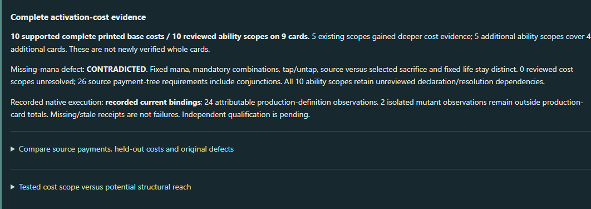
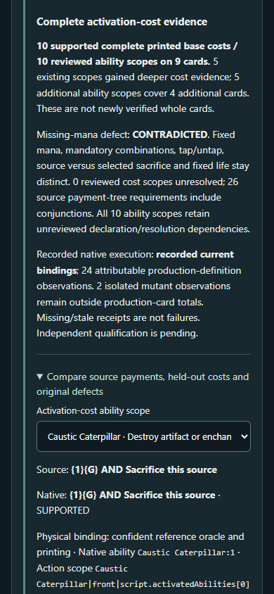

# Product Studio - Reusable Activation-Cost Fidelity

November 8, 2026. Increment 4. Reviewable application PR; no automatic merge. Independent qualification remains pending.

## What can I do now?

Open Progress, then Cards / Trust and Evidence. **Complete activation-cost evidence** compares frozen source payments with actual native trees. Inspect a selected ability, deliberate defects, recorded native state checks and potential structural reach. Discover, Progress and Primer remain the primary navigation. No objectives, commander configurations or production card definitions were added.

Launch from the application root: `.\scripts\explorer.ps1 -Port 8800 -OracleSnapshot generated/oracle/oracle-cards-20261026210159.jsonl.gz`. The usual `.\scripts\explorer.ps1` entry point is preserved; source snapshots remain explicitly selected.

## What was wrong, and what changed?

The original eight sacrifice checks accepted a Caterpillar definition with its required {1}{G} removed. Native execution showed that the mutant could activate without mana while the real definition rejected that attempt. Recognizing sacrifice was insufficient.

The new reusable method compares the **complete supported printed base payment tree**, preserving exact fixed mana, mandatory conjunction, source tap/untap, exact versus selected sacrifice and fixed life. Unsupported children/choices remain unresolved. The application reads SDK structure; Argentum pays costs. No Oracle acceptance regex, independent payment engine or card-name acceptance rule was added. Target restrictions and resolving effects are separate, unreviewed dependencies.

## Actual measurements

| Measurement | Result and scope |
| --- | --- |
| Commander-legal representation | 16,927 / 32,109 physical cards, 52.72%; availability only, unchanged |
| Bounded commander selection | 1,466 / 3,436 candidates; unsupported configuration families unchanged |
| Objectives | Four existing atomic questions; same 6,111-card Judith operational population |
| Complete printed base cost review | 10 / 10 ability scopes on 9 cards; 26 payment-tree nodes including conjunctions |
| Evidence depth and breadth | 5 existing scopes strengthened; 5 additional scopes, 4 additional source-reviewed physical cards |
| Technical held-outs | 5 / 5 ability costs supported on four cards; source-first, not blind or independent |
| Deliberate defects | 10 contradicted, 1 unresolved/unsupported, 1 outside payment scope; 0 misses within declared supported payment domain (not a general accuracy rate) |
| Fresh native observations | 26 total: 22 production expectation agreements, one incomplete and one unresolved; two isolated mutants materially differ |
| Shared execution | 3 parameterizations; 2 ability scopes need distinct target fixtures; no card-specific verification predicate |
| Potential structural reach | 4,956 cost trees on 3,880 of 16,927 confidently represented legal cards; 1,400 native trees unresolved |

Potential reach enumerates primary-definition script.activatedAbilities only; back/flip faces, granted abilities and keyword-lowered actions are excluded. It is vocabulary applicability, not source fidelity. Untap and exact colorless distinctions have structural controls but no new source-reviewed untap/colorless-payment execution cohort. Fixed-life and tap-only examples demonstrate a bounded variation beyond source-bound sacrifice.

An initial full browser attempt exhausted the unchanged 1 GB launcher heap when opening the mechanical audit after multiple research views. Progress responses now stream typed reports instead of constructing a second complete JSON tree, and scoped methods share the immutable reference baseline. The final complete suite exercises the same workload at 1 GB. Five offline catalog-comparison guards also passed using workspace-confined temporary files after the sandbox temp directory denied writes.

The additive universe index now has source review on **13 distinct cards**, **14 current ability scopes** and **91 requirement applications**. The 26 source tree nodes become ten complete-tree applications in that index, not 26 independent certifications. Execution has **39 current-binding recorded observations on 13 cards**: 15 retained prior observations plus 24 new production observations. Pass/failure/unknown card counts are 13/0/1 and overlap. The old Spark failure stays historical. There are **zero independently qualified scopes**; whole-card verification remains **Not established at catalog scale**.

## Demonstrated findings and honest limits

Missing mana, wrong quantity/color, generic replaced with colorless, missing sacrifice, missing tap, wrong granting/selected source, sacrifice moved to resolution and wrong life payment are detected. Native Caterpillar observations establish sufficient payment, clean no-mana/wrong-color rejection and the material behavior of missing-mana/missing-sacrifice mutants. Tap controls distinguish legal untapped sources from already tapped sources. Actual pool/life, tap/sacrifice/zone events, object references, owner graveyard membership and unrelated witnesses are checked.

The SDK's Forage alternative is retained as unresolved; a general mana-OR-sacrifice construct is unavailable. The correct-cost/wrong-target-effect mutant remains outside scope. Those conclusions do not rewrite the original method's misses.

Viscera Seer accepts a controlled creature owned by another player and sends it to that owner's actual graveyard. A submitted noncreature selection leaves state unchanged but reports execution failure instead of a clean illegal-action rejection: **INCOMPLETE**. An unspecified selection remains **UNRESOLVED**, with no completed-choice assurance. Contextual mana restrictions/modifiers, replacements, life-at-zero, general timing, targets and effects remain untested. Sakura's earlier exact-printing concern remains in the original evidence; this cost review uses the existing confident physical Oracle association, with different-printing bindings explicit.

## Architecture and independent review bundle

The small typed cost projection and native transaction harness feed the existing verification index. Source expectations, source/ruling captures and inspected bindings are retained under `src/test/resources/fidelity/activation-cost/`. The cost API provides raw native definitions, exact scope IDs, mutations, source references and actual execution traces. Freshness binds source/requirements, definition and ability identity, engine, support/mutant definitions and the combined harness hash. No database, replacement interpreter or approval authority was introduced.

The PR40 verification baseline and global representation baseline remain immutable. A separate `verification-cost-baseline.json.gz` records the added evidence. Its comparison is like-for-like: 5 additional source scopes, 24 new attributable production execution observations, no denominator/qualification change. Historical tests without receipts stay unindexed.

## Three guided investigations

1. Select Mogg Fanatic, then Caustic Caterpillar. Compare source-only sacrifice with {1}{G} AND sacrifice. Read the scope dependencies; neither cost pass certifies targets or resolution.
2. Expand **Remove required {1}{G}, retain sacrifice**. The new method reports CONTRADICTED. Compare the original PR40 miss below and the new mutant native observation; inspect actual state/resource differences.
3. Select Viscera Seer or Greed. Inspect the technical held-out payment and borrowed creature's owner destination. Compare the incomplete noncreature selection or unresolved Forage alternative with an actually supported payment.

## Verification and exact revisions

- `.\dev.ps1 test`: **583 passed**, zero failures/errors/skips, covering all application suites and real Argentum execution. Final tested implementation commit **1f37de571a12109d36268e3dd1da3a3c92b9a000**; original implementation also passed the complete suite before the final memory fix.
- Post-receipt activation-cost, verification-index and ResearchProgress tests: **15 passed**. Final actual-owner-state activation-cost checks: **6 passed**. `pnpm build`: passed. `EXPLORER_URL=http://127.0.0.1:8800`, `EXPLORER_BROWSER_CHANNEL=msedge`, `pnpm exec playwright test`: **31 passed**, zero unexpected/skipped/flaky; real local Kotlin checks plus existing deterministic interface fixtures.
- Four controlled `discover --commander 'Judith, the Scourge Diva' --objective <existing-id> --json --output <path>` outputs are byte-identical before/after, including eligibility, pathways, decisions and evidence. Before application `a3aa91a9ffe061a96a14e584e2db6ede6470e632`; after `9314c0efbc353fa416764b4663c5fd0af75e0ba9`; same engine and 6,111 eligible cards. Later changes affect observation assertions/evidence/presentation only.
- Fresh execution application **6fd70e848990a393b94c551d044921c14265f0c9**, recorded **2026-11-08T20:16:22.690996500Z**. Additive baseline application **43824a466dbf28a199dbf8ac8e3557d7e3d3494f**. Live screenshot application **1f37de571a12109d36268e3dd1da3a3c92b9a000**. Engine, clean maintained app-stable: **84fb6147f5b6ae11445f215ce23c3a9bb6a72db1**. No engine changes or engine PR.
- Global Oracle snapshot October 26, 2026: **081a50ef82c767523f955e914153cf988ff045a72e3765b6aa2382567f9eb53a**; population **95d869de7e43ce9bc6dbcb7ae2341192b409ce9d099885b2e8f6962b5d5a0086**. Current per-card/ruling captures and official November 6 rules are separately hashed in the frozen requirements; they do not replace the global source snapshot.
- Requirement SHA **de73dc9fea4e306e6da5ce971f243225b30afdb93d3c0218275ed1054f1d730f**; inspected bindings **e8e231f4189efd0c32836f651af3d33d9e04f7c54778be21659b05ed2970db92**; final harness **51ea3da6f2c929dab79052d712d27f7d2593e3ffa464c5b5ec6298308009aeac**. Complete baseline/receipt hashes and actual comparison/count records are in `src/test/resources/progress/activation-cost-stability.json`.
- **Not run:** separate native-module `just test-class CostHandlerPayLifeTest` (just executable unavailable). No native-module suite pass is claimed. No independent approval, universal activation legality, general alternative/conditional payment execution, broad target/effect or whole-card verification was performed.

## Actual visual review

Desktop and 390px captures are from the running Kotlin-backed application, not mockups. Keyboard entry opens the evidence drill-down, the select switches real source scopes, and the page fits each viewport without horizontal document overflow.

## Next decision

Authorize a **separate, source-and-native examination of the ten-scope cost bundle**, concentrating on selected-creature payment/rejection boundaries and the declared payment-versus-declaration exclusions. This is the smallest next step that can challenge the evidence and decide a defensible bounded approval scope. Do not broaden certification or begin another implementation increment automatically.

See [technical definitions, preserved failures and reproduction commands](ACTIVATION_COST_FIDELITY.md).
