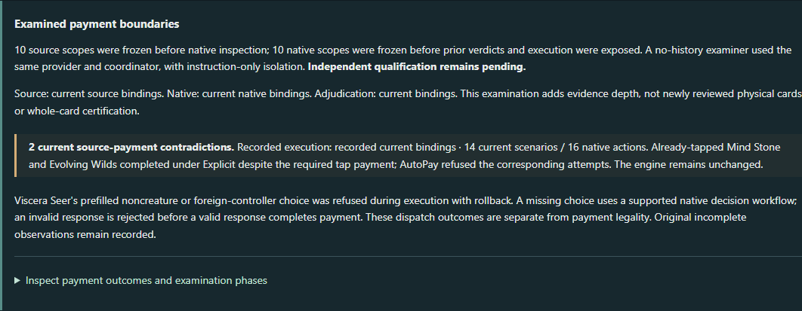
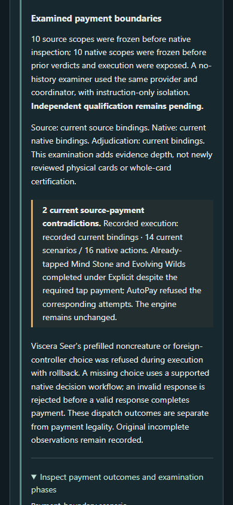

# Product Studio - Activation-cost examination

Increment 5 examines the evidence rather than increasing certification counts. Ten printed-base-cost scopes still agree structurally with source requirements, but genuine native execution exposed two payment-enforcement failures. No engine code or compatibility baseline changed. This application PR preserves the findings and makes them inspectable.

## What can I do now?

Launch ` .\scripts\explorer.ps1 `, or select the retained explicit snapshot with:

```powershell
.\scripts\explorer.ps1 -OracleSnapshot generated/oracle/oracle-cards-20261026210159.jsonl.gz
```

In **Progress > Cards / Trust and Evidence > Phased activation-cost examination**, inspect source, native and adjudication phases separately, select a payment scenario, and expand its actual native results and state. Discover, Progress and Primer remain the main navigation. Opening the report reads recorded observations; it does not run games or generate model judgments.

## What did we learn?

| Finding | Actual scope and limit |
| --- | --- |
| Printed payments agree | Ten ability scopes on nine cards; no new source-reviewed card claims. Both Mind Stone abilities are distinct scopes. Full activation and resolution remain outside the review. |
| Selected-creature semantics | Viscera Seer pays with itself, another controlled creature, or a controlled creature owned by the opponent. Events, owner graveyard and object generation were checked. |
| Invalid prefilled selection | Noncreature and foreign-controller selections fail downstream as ExecutionFailed, with no events or committed payment. Initial affordability passes because another legal sacrifice exists. These remain UNKNOWN in the aggregate, not clean IllegalAction passes. |
| Missing selection | The engine presents an eligible SelectCardsDecision. An invalid reply is IllegalAction, preserves the pending decision, then a valid reply pays successfully. The older harness limitation remains recorded historically. |
| New native contradiction | An already tapped Mind Stone mana ability and Evolving Wilds incorrectly complete with Explicit(emptyList()), without a tap event. Tapped AutoPay controls refuse, and untapped Explicit controls actually tap. These are unmodified production definitions. |
| New structural control | A test-only Viscera Seer variant requiring another creature is rejected by the unchanged shared cost checker. Prior missing-mana, wrong-target/effect and alternative-cost findings are retained. |
| Evidence integrity | Raw CRLF phase artifacts and Git LF transport hashes are both verified. The raw freezes remain in compressed archives; no source expectation was rewritten to cure staleness. |

The tap discrepancy arises from explicit payment bypassing ordinary affordability validation, combined with the tap payment handler treating an already-tapped no-op as successful payment outside locked-cost replay. This is payment enforcement, not a mistranslated printed cost. The exact path, native files and bounded reproduction are documented in [the technical examination](COST_EXAMINATION.md) and raw evidence. Mind Stone's draw ability, Untap, other strategies, contextual changes and replacement effects have not been demonstrated by these scenarios.

## What was independently examined?

A no-history `source_examiner` agent derived Phase A using original Oracle/ruling captures and the full official November 6 rules before receiving native definitions. Phase B inspected fresh native exports and engine code without receiving the original application verdicts. Phase C adjudicated original checks and actual native receipts. It predicted the explicit tap concern before the new execution result was available.

This was instruction-based separation within the same provider/coordinator and shared filesystem. It was not a blind external human review or an enforced isolation boundary. The coordinator previously knew the old conclusions. The examiner did not itself execute the native scenarios. No approval was issued; formal independent qualification remains pending.

The review-ready package is `src/test/resources/fidelity/cost-examination/`. Begin with `inputs.json`, freeze a source derivation, then inspect `native-inputs.json`, freeze the native assessment, and only then consult comparisons and receipts. Raw freezes, source provenance, exact native bindings, original and updated adjudication, consulted-file histories, limitations and hash mappings are retained. The existing qualification gate remains authoritative.

## Current measurements

These overlap; they are not a certification funnel.

| Measurement | Result |
| --- | --- |
| Global representation | 16,927 / 32,109 Commander-legal physical cards; 52.72%, unchanged |
| Commander selection | 1,466 / 3,436 bounded single-commander candidates, unchanged |
| Objectives | Four bounded objectives; unchanged search policies and Judith population |
| Current source review | 13 physical cards, 14 ability scopes, 91 requirement applications, unchanged |
| Current execution | 53 attributable production scenario observations on 13 cards; 13 cards with passes, two with failures and one with unknowns (overlapping) |
| Historical execution | One historical observation; not a current-engine pass |
| New receipt | 14 scenarios, 16 native actions: ten bounded expectations supported, two atomic refusals with diagnostic limits, two source-payment contradictions |
| Qualification | Zero qualified scopes; whole-card completeness not established at catalog scale |
| Potential cost vocabulary | Prior 4,956 cost trees / 3,880 cards remains potential applicability, not source review |
| Candidate tap investigation population | 2,965 projectable primary-definition source-tap trees / 2,102 represented legal cards; potential investigation reach, not confirmed affected cards |

Only the final new receipt's 14 observations enter the existing index. The first receipt and reviewer readings are not counted again. Comparison with PR #41's immutable verification-cost baseline reports 14 new execution observations, two newly contradictory observations, no new source scopes, no stale reclassifications, no resolved concerns, no changed population and no qualification change. Prior global and verification baselines remain unchanged.

## Architecture and reproducibility

The compact application-owned `CostExamination` projection joins phase identities, raw/canonical hashes, exact native definitions and existing scope-aware evidence. `CostPaymentBoundary` parameterizes genuine native scenarios through the existing Lab execution path; it does not implement payment legality. Argentum owns validation, choices, payment, events and state. The existing index deduplicates observations and uses currentness bindings; existing qualification/completeness gates are unchanged. Raw source and native results remain inspectable through the existing Progress area and `/api/v1/progress/cost-examination`.

| Revision | Exact identity |
| --- | --- |
| Starting merged main (PR #41) | `0b23d5e16ac3145118a4ae15e7a66c99b610d24a` |
| Full Kotlin verification | `5d1b9381f4dcf070c64392d0df87e3e33a963e79` |
| Live browser and screenshots | `f20da9b66172743c6cea91f7c967552445b48517` (subsequent commits contain delivery records only) |
| Native receipt execution application | `ec6bc9989df4558b9e4db3fda24aa14a5327aba6` |
| Clean unchanged app-stable engine | `84fb6147f5b6ae11445f215ce23c3a9bb6a72db1` |
| Selected global snapshot | `oracle-cards-20261026210159.jsonl.gz`, dated 2026-10-26T21:01:59.922+00:00 |
| Global snapshot SHA256 | `081a50ef82c767523f955e914153cf988ff045a72e3765b6aa2382567f9eb53a` |
| Global physical population SHA256 | `95d869de7e43ce9bc6dbcb7ae2341192b409ce9d099885b2e8f6962b5d5a0086` |
| Full November 6 rules SHA256 | `524f5195a1e5f54bb13c735edf399ac717a4458e2713f398d1a3e6877186b829` |
| Final new native receipt SHA256 | `f860245a9a137f1d12af8246b4e7ddbff9b27081dee15f0175798e8b4702b573` |
| New scenario harness SHA256 | `c9badf76708f04157e494746973fb5c5d7ff3bc8e24f4a1b6e265acbc4629591` |
| Original cost harness SHA256 | `51ea3da6f2c929dab79052d712d27f7d2593e3ffa464c5b5ec6298308009aeac`, unchanged |

The final receipt was actually observed at `2026-11-09T00:05:29.460068Z` (November 8 local time). That original timestamp is retained. Per-phase raw and Git transport hashes, exact source/printing/face/ability bindings and retained initial receipt identities are in the package and [stability receipt](../src/test/resources/progress/cost-examination-stability.json).

## What tests actually ran?

- `.\dev.ps1 test :assistant:installDist`: **587 tests, 82 suites, zero failures/errors/skips**. Assertions deliberately preserve two observed native failures; this is not an engine correctness certificate.
- `pnpm --dir web build`: passed. The initial JSX build failure was corrected before the successful build.
- `pnpm exec playwright test` in `web`, with `EXPLORER_URL=http://127.0.0.1:8801`, `EXPLORER_BROWSER_CHANNEL=msedge`: **32 passed, zero failed/flaky/skipped**; includes real Kotlin, navigation, keyboard, phase/receipt drill-down and desktop/390px checks.
- `scripts/test-catalog-comparison.py`: five offline comparison tests passed.
- Fresh native application harness: 14 scenarios / 16 actions with actual typed results, before/after state, events and resources. Two scenarios deliberately retain source contradictions.
- Fresh CLI discovery before/after: all four complete reports byte-identical over the same 6,111-card Judith population and exact engine. Starting main `0b23d5e` compared with `ec6bc998`; tokens, deaths, graveyard state and reanimation all unchanged. Full hashes/counts are retained in the stability receipt.
- Native module `just test-class ActionProcessorAtomicityTest --rerun`: **not executed; just is unavailable**. Application execution is not native-module regression verification.

No automatic GitHub Actions, engine changes, new objectives, Commander configurations, source certifications or subsequent increment were performed.

## Visual review and guided investigations

Actual Kotlin-backed application screenshots at desktop and 390px; no mockups:





1. Open Progress and compare Caustic Caterpillar's `{1}{G}` plus sacrifice with Mogg Fanatic's self-sacrifice. Inspect source/native phases; agreement is bounded to printed payment.
2. Select Viscera Seer's borrowed-creature, noncreature and missing-choice cases. Inspect destination and generation, downstream refusal, invalid response and successful response. Distinguish ExecutionFailed from clean IllegalAction.
3. Select Mind Stone's already-tapped Explicit case and compare AutoPay and untapped controls. A correct printed cost still has a demonstrated native payment failure. Targets, timing and resolving effects remain unverified by cost agreement.

## Known limits and one next decision

No external human examination or independent approval occurred. Relevant whole-card scopes are not exhaustively enumerated. Existing unindexed historical evidence remains uncounted; historical/stale evidence is not refreshed by rereading it. Invalid-prefilled-selection diagnostics remain bounded. The two tap failures are demonstrated only on the tested abilities/strategy. Cost modifications, replacements, source permissions, timing, targets and resolving effects remain outside the cost assurance. Candidate catalog reach is not fidelity coverage.

Recommend exactly one bounded investment: **a separate native source-tap payment-enforcement correction across payment strategies**, with focused native regressions and complete application compatibility on an isolated candidate, followed by explicit approval before app-stable integration. This increment does not start that correction and does not merge its application PR.
