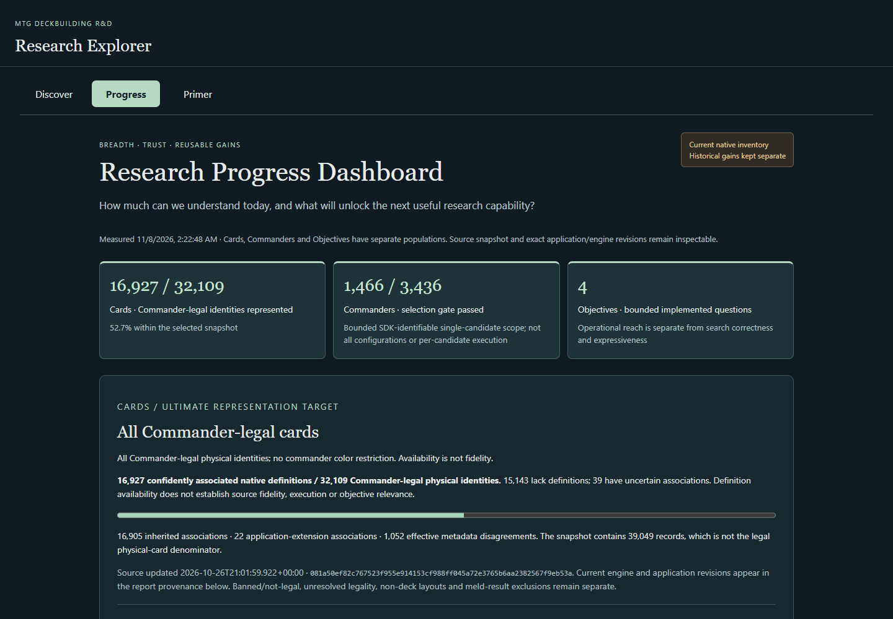
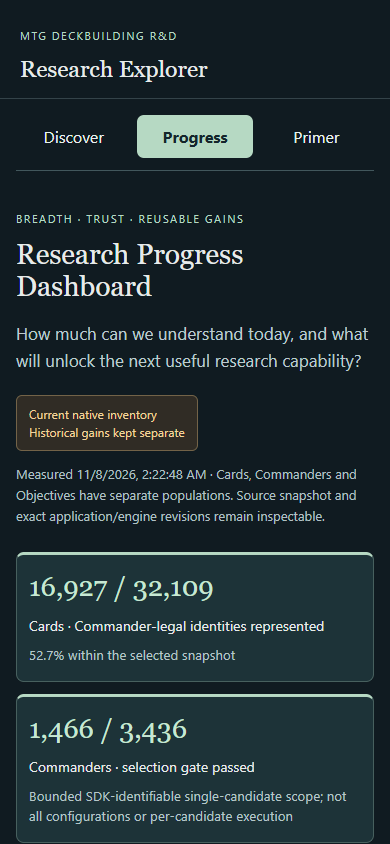

# Product Studio — Global Commander Coverage & Reusable Verification

Increment 2 · November 8, 2026 · Reviewable implementation; product acceptance remains with the user.

Progress now presents Cards, Commanders and Objectives as separate research dimensions. Discover and Primer remain available, and no new primary research destination was added. No discovery policy, native definitions, commander configuration support or objectives changed.

## What can I do now?

Inspect the whole Commander-legal card universe from the selected snapshot, compare it with Judith's restricted pool, inspect single-commander selection blockers, examine all four objective searches, and review a small reusable sacrifice-fidelity experiment.

The Windows launcher remains ` .\scripts\explorer.ps1 `. Select the pinned source explicitly to reproduce global coverage:

```powershell
.\scripts\explorer.ps1 -OracleSnapshot generated/oracle/oracle-cards-20261026210159.jsonl.gz
```

See [snapshot setup and metric definitions](GLOBAL_COMMANDER_COVERAGE.md) if the source is absent. Without a compatible selected snapshot the dashboard says **Not measured**, rather than inventing a zero.

## Cards

**16,927 / 32,109 Commander-legal physical cards have confidently associated native definitions (52.72%).** Of these, 16,905 come from inherited Argentum definitions and 22 from application extensions. Availability does not establish translation fidelity.

There are 15,143 missing native definitions and 39 uncertain associations (2 ambiguous, 37 requiring identity review). Effective source/native metadata disagreements affect 1,052 associated definitions; these overlap with availability and must not be added to the missing-card count.

The snapshot contains 39,049 source records: 32,116 with legal Commander status, 83 banned and 6,850 not legal. Seven legal meld-result records are excluded as nonphysical standalone cards, yielding the 32,109 denominator. No legality or pool records are unresolved in this snapshot. Printings and faces are not separately counted. Judith's external eligible pool remains 12,828 physical cards, with 6,658 confident associations; existing discovery examines 6,111 eligible native physical cards.

## Commanders and objectives

**1,466 / 3,436 SDK-identifiable single-commander candidates pass the actual selection gate.** This is a bounded candidate denominator, not all possible legal commanders or configurations, and not successful discovery execution for every candidate. There are 1,772 missing definitions, 6 uncertain associations and 192 unresolved or blocked candidates. Background components and special noncreature forms remain separately identified. Partner, Background pairings and alternative pre-game arrangements are unsupported.

Four existing bounded objective questions operate on the same 6,111-card Judith-native population:

| Objective | Matching cards | Unresolved cards | No emitted pathway cards | Unsupported native records |
| --- | ---: | ---: | ---: | ---: |
| My nontoken creatures die | 487 | 373 | 3,810 | 8,702 |
| Return my creatures from the graveyard | 104 | 85 | 4,433 | 8,318 |
| Create creature tokens | 346 | 48 | 5,515 | 8,702 |
| At least one creature card in my graveyard | 508 | 527 | 4,823 | 8,537 |

Card categories overlap. Native records are a different unit. A structural match is conditional possibility; no emitted pathway is not a proven nonmatch. **Objective correctness is not measured at catalog scale.** These operational counts do not establish precision or recall. Cross-card dependencies, complementary packages, generalized resource/timing analysis, substitutions and competitive-position evaluation remain outside current expressiveness.

## Can verification scale?

The author-led source-bound sacrifice pilot reviews one ability each on Mogg Fanatic, Seal of Fire, Evolving Wilds, Spark Elemental, Reckless Barbarian and Ball Lightning. The last two are held-out variants; prior investigations were known, so this is not a blind independent experiment.

Eight generic structural checks produce 48 supported requirement applications, zero contradictions and zero unresolved structural results. Six object-generation requirements remain untested by static inspection. Two reusable ordinary execution patterns plus five existing curated positions produce 11 fresh passing scenario observations across six distinct cards. This is ability-scoped evidence, not whole-card certification or independent qualification.

Seal of Fire is the noncreature control; animated Evolving Wilds separates departure characteristics from the arriving land card; missing-target Mogg and Spark's zone round trip retain adverse controls. Deliberately deceptive requirement variants are rejected by tests. Potential structural reach is reported separately and does not inherit source-review status. Historical Spark failures remain bound to their original engine revision.

## Three guided investigations

1. Open Progress → Cards. Inspect the global legal denominator, exclusions and uncertain associations, then compare Judith's narrower population.
2. Inspect Commanders and filter Daretti to see a legal source candidate with no native definition. Compare Krenko and Ishai single selection, inspect unsupported families, and explore all four objective questions and their records.
3. Inspect the sacrifice cohort and held-out Reckless Barbarian. Compare Seal and animated Wilds, then inspect the execution receipt and Spark historical failure boundary. Distinguish reviewed scopes from potentially reusable reach.

## Evidence and next decision

Validation passed: **571 Kotlin tests**, **29 Windows Edge browser checks**, and **11 fresh native pilot scenarios**. All four full controlled discovery reports are byte-for-byte identical to merged main on the same 6,111-card population and maintained engine. The first browser run exposed a duplicate commander anchor, repaired before the final full rerun; the evidence receipt preserves that failure and an overlapping package-refresh CLI failure.

Actual desktop overview (1440px) and mobile overview (390px), captured from the running Kotlin-backed application:





Supporting views:

- [Global card population](images/global-coverage/1440-global-cards.png)
- [Commander selection scope](images/global-coverage/1440-commander-coverage.png)
- [Objective reach and quality boundary](images/global-coverage/1440-objectives.png)
- [Reusable fidelity at 390px](images/global-coverage/390-fidelity-pilot.png)

The [technical evidence receipt](GLOBAL_COMMANDER_COVERAGE.md#delivery-evidence) records exact revisions, source hashes, validation and screenshots. The immutable baseline preserves the full source identity population; historical Judith comparisons remain separate. Kotlin projects existing catalog audits, eligibility gates, mechanical facts, discovery queries and assurance records. React presents those results without a new rules interpreter.

The most useful next bounded decision is **independent review of the pilot's exact source requirements and evidence bundle**, including held-out and deceptive controls, before broadening fidelity claims. That investigation has not been started.
