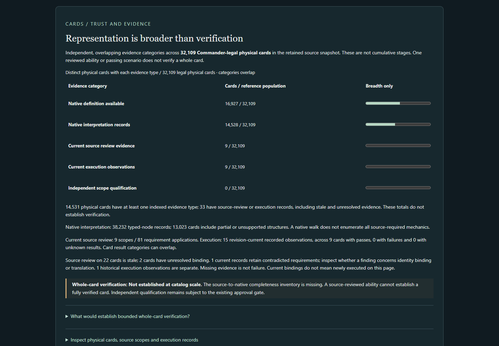
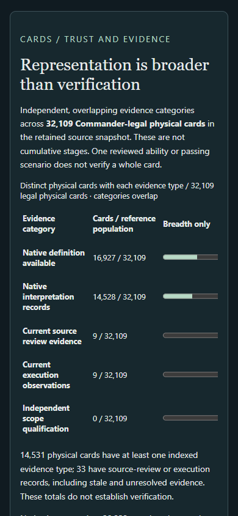

# Product Studio — Verification Coverage & Independent Fidelity Challenge

Increment 3 · November 8, 2026 · Reviewable implementation; independent qualification and product acceptance remain separate.

## What can I do now?

Open **Progress → Cards / Trust and evidence** to compare native representation with the actual breadth of interpretation, source review and engine observations. Inspect a physical card's exact source, native action scope, requirements, definition fingerprint, engine revision and unresolved limits. The sacrifice challenge shows what the unchanged verification method detects and what it misses. Discover, Progress and Primer remain the primary experience.

The Windows launcher remains ` .\scripts\explorer.ps1 `. Global live coverage uses the same explicit snapshot option:

```powershell
.\scripts\explorer.ps1 -OracleSnapshot generated/oracle/oracle-cards-20261026210159.jsonl.gz
```

The verification view uses the packaged PR39 reference universe and validates its native identity bindings; it does not download a new source or silently replace the denominator.

## Actual indexed measurements

All card counts below use the same **32,109 Commander-legal physical-card reference population**. Categories overlap; these are not cumulative certification stages.

| Evidence | Physical cards | Scope and limitation |
| --- | ---: | --- |
| Confident native definition available | 16,927 (52.72%) | Availability only; unchanged from PR39 |
| Attributable native interpretation records | 14,528 | 38,232 existing walker records; 13,023 cards include partial/unsupported records; no whole-card completeness claim |
| Current source-review evidence | 9 | Nine partial ability scopes; 81 requirement applications: 71 supported, one exact-printing contradiction, nine execution-only UNTESTED |
| Stale source-review evidence | 22 | Existing extension ledger; broad review scope and material concerns preserved |
| Unresolved source/native review binding | 2 | Augur of Skulls and Qasali Pridemage have no native definition |
| Current engine execution observations | 9 | 15 passing bounded recorded observations; no current production failure/unknown observation in the indexed cohort |
| Historical execution evidence | 1 | The documented old Spark failure remains historical, with its missing exact old fingerprint explicit |
| Independent qualification | 0 | No existing gate-accepted independent approval; 21 provisional and one blocked ledger scope; 32,087 cards not measured under that process |
| Whole-card verification | Not established | No defensible complete-card numerator or percentage |

There are **49 indexed source/execution records covering 33 physical cards**, including stale and unresolved records. Combining these with native interpretation gives **14,531 physical cards with some indexed evidence**. “Some evidence” does not mean verified. The deliberately erroneous mutant is excluded from all production-card execution totals.

The immutable baseline preserves these units, reference identities, exact revisions and evidence records for future comparisons. Earlier representation and Judith history are separate and unchanged.

## Does the method detect meaningful errors?

The original eight static sacrifice checks are unchanged. New source requirements were frozen before examining implementations. Three additional native scopes are available—Sakura-Tribe Elder, Hapless Researcher and held-out Caustic Caterpillar—and two initial source cases remain missing-native/unresolved. Public mechanics and prior work were known to the same agent; this is not independent or fully blind certification.

| Challenge outcome | Actual finding |
| --- | --- |
| Four detected contradictions | Missing target, missing tap, wrong arriving characteristics, wrong trigger step |
| Two variants not accepted | Wrong/granting source and cost changed to effect remain unresolved rather than being supported |
| Two missed defects | Missing required mana and wrong target/effect filter still pass the original static method |
| Two execution-dependent classes | Object generation and owner/replacement behavior are not established statically |

The real Caustic definition correctly rejects activation without `{1}{G}`. A deliberately incorrect version with that payment removed activates and sacrifices with no mana. The native observation **DIFFERS** from the frozen source requirement and is retained as an isolated method-challenge result. It is not a production-card failure or new integration.

Sakura also exposes a binding limitation: the current source capture is a different printing from its native definition. The old exact-printing check contradicts that binding, while the unchanged global audit confidently associates the same physical Oracle card. The dashboard preserves this distinction instead of alleging a confirmed rules mistranslation.

## Three guided investigations

1. Compare **16,927 available definitions** with the independent evidence rows. Read the denominator, overlapping units and whole-card limitation.
2. Inspect **Hapless Researcher**: sacrifice payment has bounded evidence; resolving draw/discard and complete source-scope accounting remain outside review. Compare Spark's CURRENT/HISTORICAL records and Tatterkite's stale review with its preserved concern.
3. Open **Challenge findings**, inspect the missing-mana and wrong-target-filter variants, and compare the isolated native mismatch with the real definition's correct missing-mana rejection.

## Architecture, verification and next decision

The Kotlin index projects existing global associations, native walker records, source requirements, pilot/Lab receipts and the extension approval gate. Exact physical/face, native-action, requirement, definition and engine identities remain inspectable. Duplicate observations deduplicate; conflicting IDs fail closed. Unreviewed references and unexecuted attempts cannot inflate higher evidence stages. No database, second rules interpreter or qualification authority was added.

The full Kotlin suite passed **577 tests, zero failures/errors/skips**. All four full discovery exports are byte-for-byte identical to a clean merged-main control, each examining the same 6,111 eligible physical cards on the same engine. Current native execution is explicitly recorded; passing test names alone are not ingested as observations. Final browser results and screenshots are recorded in the [technical delivery receipt](VERIFICATION_COVERAGE.md#delivery-receipt).

Known limits include unindexed historical tests, incomplete whole-card scope enumeration, incomplete resolving-effect and owner/replacement coverage, the original method's missed cost/target constraints, and absent independent approval. No standalone engine suite or non-Windows/non-Edge interface checks were run; the maintained engine source was unchanged.

The full Edge suite passed **30 checks**, including real Kotlin-backed verification/discovery, keyboard inspection, the retained baseline, historical failure and actual native adversarial receipt. The exact code, engine, source and baseline hashes are in the technical receipt.

Actual running application screenshots:





- [Partially evidenced Hapless Researcher](images/verification-coverage/desktop-partial-card.png)
- [Adversarial method findings](images/verification-coverage/desktop-challenge.png)
- [Desktop three-section overview](images/verification-coverage/1440-overview.png)
- [390px three-section overview](images/verification-coverage/390-overview.png)

Recommend one bounded next decision: **a separate source-first review of a complete activation-cost requirement**, using the missed `{1}{G}` mutant as a mandatory negative control before broader fidelity promotion. This follow-up has not begun.
