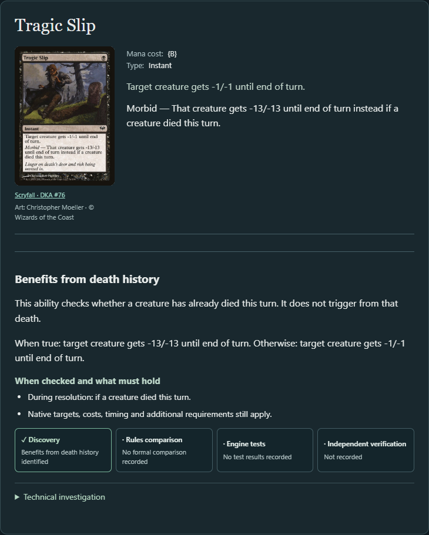
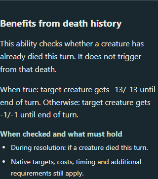

# Discover: A creature died this turn

**Product Studio review.** Discover now has a state objective for abilities that check whether a creature died earlier in the current turn. Select **A creature died this turn**, run Discover, and filter **Mechanic → Benefits from death history**. The selected ability shows its checkpoint, condition, and both outcomes. The existing **My nontoken creatures die** objective continues to answer a different question and keeps its prior results.

For a hands-on review, launch with `.\scripts\explorer.ps1` from the application checkout, open the address printed at startup, and run the new objective under **Judith, the Scourge Diva**. Inspect **Tragic Slip**, then switch to **My nontoken creatures die** and inspect **Grim Haruspex** under **Benefits from deaths** to compare the two relationships.

1. **Reusable capability.** The existing native pathway walk can retain a typed condition and its scope, exact action and gate/effect paths, checkpoint, outcomes, prerequisites, and any incoming event on the same ability. The query evaluates the condition's compatibility with an explicit anchor and checks for an enabled effect or a like-for-like magnitude change. It does not fabricate a legal target, a payable cost, a battlefield, or successful execution. Full reports retain the native condition, branches and unsupported context.
2. **Tragic Slip.** The native spell checks current-turn creature-death history **during resolution**. Its same-target, same-duration effects are −13/−13 when true and −1/−1 otherwise. The global condition is not restricted to our nontoken creatures. In two native runs, an opposing 2/2 survived the ordinary effect and died when a different opposing 2/2 had already died that turn. These runs demonstrate the difference for those positions. They do not test every timing, target or token case. Hunger of the Howlpack shows the same condition increasing counters instead. Denethor, Ruling Steward shows an own-creature condition checked at the end-step trigger and again at resolution; its separate sacrifice ability is not the qualifying branch.
3. **Event versus state.** Grim Haruspex draws from a direct trigger for another nontoken creature you control dying. That trigger remains an event result and is not a history check. Tragic Slip's old specialized removal result is still separate from triggered death responses. An interactive consequence is not grounds for exclusion: the retained source for Grave Pact establishes its trigger and other players' sacrifices. The candidate CLI still reports `Card not found` for Grave Pact; the existing synthetic control covers an opponent-sacrifice subset and is not a native Grave Pact result.
4. **Internal history.** Tannuk, Memorial Ensign retains its land-entry trigger and the typed comparison of its own ability resolutions this turn. The comparison is tied to the source ability, not promoted as an independently discoverable death or battlefield state. The native execution-count update and gated draw are still unresolved for extraction.
5. **Generalization.** Scute Swarm retains its land-entry event and the independent battlefield count on that action. The shared count predicate accepts six controlled lands and rejects five. The native output pair, including the copy, remains unresolved as a supported effect change. A separately labeled synthetic land-entry fixture uses the same count guard with two comparable draw branches; its incoming event and state beneficiary both remain supported. No second production objective was added.
6. **Coverage limits.** The query supports direct death-history predicates with established player/filter semantics and fixed battlefield count comparisons with an explicit compatible witness. It records supported resolution guards, activation restrictions and intervening-if checkpoints. Compound or negated polarity, unbound players, deferred/nested contexts, and unrecognized outcome changes can remain UNKNOWN. There is no general evaluation of continuous or replacement effects (including Hardened Scales), casting gates or cost discounts, unsupported token/copy alternatives, internal history execution, or causal chains that establish state. Missing definitions provide no native match.
7. **Preservation.** The [comparison receipt](evidence/state-dependency-comparison.json) compares entire reports, including eligibility, paths, decisions, prerequisites, facts and unsupported structures, rather than only match counts. The legacy removal projection is diagnostic: it withholds only exact action/gate/native-effect intersections supported by the new resolution-history query, then checks whether the card still has another accepted pathway. Mixed legacy timing, discounts and unresolved forms prevent treating the whole specialized category as one history rule.
8. **Counterexamples.** An ordinary damage spell can help establish the state without benefiting from it. An effect on a sibling ability cannot borrow a qualifying condition. A negated condition with a stronger false branch cannot be rejected from the true branch alone, so unresolved polarity stays UNKNOWN. A land-entry trigger does not establish its land-count condition. Equal effects on both branches provide no distinct benefit. In the catalog, Gravelighter stays UNKNOWN: the death check is understood, but the two branches draw and force sacrifice, respectively. Skirsdag High Priest's history-gated token activation is supported; its native tap costs still apply.
9. **Research conclusion.** The same typed query can now distinguish a real historical dependency, an independent threshold on a triggered action, and internal execution bookkeeping. That is evidence for reusable interpretation across conditions. It is not a catalog-wide precision or recall estimate. The frozen source cohort is author-selected, and synthetic cases verify contracts rather than authored card definitions.
10. **Next decision.** Add typed conditional cost changes at casting or activation as one bounded increment. Preserve the actor, checkpoint, base and conditional payment, and native condition; then measure which legacy removal pathways can move to state discovery without losing distinct event pathways or uncertainty. This increment does not begin that work.

The [frozen source cohort](../src/test/resources/regression/state-dependency-sources.json) retains printing and Oracle IDs, original card text and source links. The retained snapshot is `oracle-cards-20261026210159.jsonl.gz`, SHA-256 `081a50ef82c767523f955e914153cf988ff045a72e3765b6aa2382567f9eb53a`.

## Catalog results

| Commander | Eligible cards | New state MATCH cards / pathways | New state UNKNOWN cards / pathways | Legacy death-enhanced pathways retained in production | History-only pathways in the diagnostic projection |
| --- | ---: | ---: | ---: | ---: | ---: |
| Judith, the Scourge Diva | 6,111 | 6 / 6 | 9 / 9 | 25 | 2 |
| Krenko, Mob Boss | 3,472 | 0 / 0 | 1 / 1 | 8 | 0 |
| Kenrith, the Returned King | 15,955 | 14 / 14 | 15 / 15 | 30 | 2 |

The history query emitted no NO_MATCH rows in these three pools. That does not turn the unreported population into nonmatches; explicit NO_MATCH controls are exercised in the tests. The receipt lists every matched and unresolved card. The diagnostic projection would move Tragic Slip and Tragic Banshee out of the event objective in Judith and Kenrith; neither has another accepted death pathway in those runs. The other 23 and 28 legacy matches were not proven history-only by this check. No result moved in production.

All eight original Judith and Krenko reports and Kenrith's original death report are **byte-for-byte identical**. The preserved MATCH totals below use distinct cards / pathways; the receipt also records UNKNOWN, NO_MATCH and the full-report hashes.

| Original objective | Judith | Krenko |
| --- | ---: | ---: |
| My nontoken creatures die | 551 / 566 | 220 / 225 |
| Reanimate own creatures | 104 / 106 | 18 / 19 |
| Create creature tokens | 346 / 363 | 182 / 190 |
| Stock own graveyard | 508 / 535 | 230 / 239 |

## Reproduction and verification

- Live application baseline: `59805cecdb173efc6195b5cd74739eedaa549d38`. Full application gate and catalog comparisons ran at `6b8dff334cdbee13a85ef51ea9cfba742a960581`. The Primer copy and its browser assertions are at `00c92c910bcc279fdf8e1395b6ece6a76a7ba784`. Final presentation revision `1ad02cf3429e3b7b470134a0039fba8ffee93bb5` adds the incoming trigger to the explanation and does not change extraction, admission, CLI reports, or the Tragic Slip screenshots. All application revisions use unchanged Argentum `bd26b756b8b4d347f19e92bc77ef020919ebfa48`. The retained Judith and Krenko baseline reports were produced at `7fdee05`; `git diff 7fdee05 59805ce -- src/main` is empty. Kenrith's death baseline is the retained PR #49 operational report. The comparison checks the serialized eligible population and engine identity.
- The headless reports use `mtg-assistant discover --commander "<commander>" --objective <id> --json --output <path>`, one CLI process per context and objective. Name the output `<judith|krenko>-<objective-id>.json`, `kenrith-death.json` or `kenrith-history.json`. Run `python scripts/compare-state-dependency.py --legacy-dir generated/creature-inputs/after --candidate-dir <new-report-dir> --kenrith-before generated/selection-composition/kenrith-current.json --output <receipt.json>` from the application checkout with the retained raw reports present.
- `bash scripts/verify.sh full` exited 0: **674 application tests, zero recorded failures, errors or skips**, followed by distribution build and the standard catalog gate. The current gate had zero confirmed benchmark mismatches and no changes in the identical-report control. Its older historical fingerprints still differ; the separate current-baseline comparison above uses exact files and no normalization. The application suite includes the five new state-dependency tests, two native Tragic Slip scenarios, all-objective HTTP/CLI agreement, and existing death-response and creature-input regressions.
- `./dev.ps1 test --tests '*StateDependencyTest' --tests '*DeathHistoryScenarioTest'` passed all seven tests again on the final presentation revision, including the assertion that Denethor's incoming trigger is explained separately from its history check.
- `./dev.ps1 installDist`, `pnpm install --frozen-lockfile`, and `pnpm build` passed. Four Edge Playwright checks passed with `pnpm exec playwright test state-dependency.spec.ts event-outcomes.spec.ts creature-inputs.spec.ts` against the running isolated Kotlin app. Two updated Primer checks passed with `pnpm exec playwright test live.spec.ts -g 'Primer distinguishes objective questions'`. The first browser attempt reached the port before it was ready; the completed run waited for the health endpoint. The screenshots above are from the running application at 1365 px and 390 px.
- Earlier verification caught a fixture type mismatch (native event pattern versus trigger specification) and an optional bulk export that exhausted the 1 GB Gradle test heap. The fixture now uses the native trigger DSL; the headless catalog receipts are generated separately from the test JVM. No engine code was changed. A standalone engine suite, unrelated opt-in research exports, and the full browser matrix were outside this verification; the selected native integration tests and browser workflows are scoped observations, not independent card qualification.
