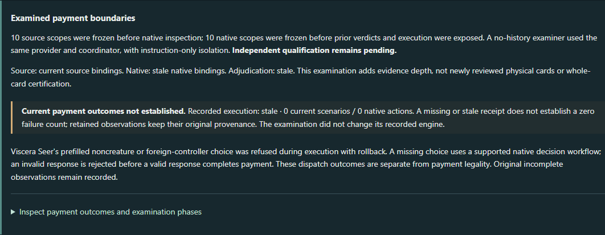

# Mandatory source-tap payment correction

Product Studio delivery, 9 November 2026. Engine candidate `f6b82f0f966e1653ed702643924cfaeee92833fb`; application compatibility candidate `6a74ca734397cd99246ce50907f79cf38533e242`, based on main `1ba84fe32e087a11ad580b42e909f2d46b2f7442`. The normal clean app-stable checkout remains at `84fb6147f5b6ae11445f215ce23c3a9bb6a72db1`. No merge or new discovery work is included.

## Root cause and correction

The original diagnosis was accurate. `ActivationValidator.checkCostPayable` returns early for Explicit payment to bypass the automatic mana solver. That also skipped its source-tap affordability check. `CostHandler` then treated the shared tap operation's already-tapped no-op as successful cost payment. Thus validation and payment both admitted an unpaid mandatory component.

Three production files change. Validation checks mandatory source `{T}` independently of mana selection; the source-tap shape query follows nested composites; and the cost payer rejects an absent or already-tapped source before invoking the shared tap operation. Existing transaction rollback handles a later payment failure. The automatic mana solver bypass, locked-cost replay protection, and shared effect-tap behavior remain intact. No card definitions, SDK models, discovery policies or card-name exceptions change.

This is bounded to mandatory source `AbilityCost.Tap`. It does not claim a general payment solver audit.

## Before and after

The same 26 native regressions were run first in tests-only commit `cd7507e49e2fc98c31e3fabe112b9fcea10f7722` (production identical to old stable), yielding 9 expected failures and 17 passes, then on corrected production. The original two failures reproduce directly in the engine.

Each principal action is `ActivateAbility(player-1, card-1001, <ability>, paymentStrategy=Explicit([]))`, with the source initially tapped. Native ability IDs are one-based; the application's scope indices are zero-based.

| Action / initial payment resources | Old stable observation | Corrected candidate observation |
| --- | --- | --- |
| `Mind Stone:1`, no mana needed | Done; adds 1 colorless; no source TappedEvent | IllegalAction; exact original state instance; no events |
| `Evolving Wilds:1`, no mana needed | Done; sacrifices source to owner's graveyard and stacks ability; no source TappedEvent | IllegalAction; exact original state instance; no events |
| `Mind Stone:2`, 1 floating colorless | Done; spends mana, sacrifices source and stacks ability without source tap | IllegalAction; floating mana/source/zones/stack unchanged; no events |
| Held-out `Hedron Archive:1`, no mana needed | Done; adds 2 colorless without source tap | IllegalAction; exact original state instance; no events |
| Held-out `Hedron Archive:2`, 2 floating colorless | Done; pays mana, sacrifices and stacks ability without source tap | IllegalAction; exact original state instance; no events |
| Tapped `Mind Stone:2`, Explicit selects a Forest | Done; Forest taps and pays, Mind Stone sacrifices without tapping | IllegalAction before mana production; both sources unchanged; no events |
| Synthetic `{1}, {T}, {T}, sacrifice` on initially untapped source, Forest selected | Done after only one source tap | ExecutionFailed on second tap; entire activation rolls back, including Forest mana/tap; no committed events |

All five production ability cases also have untapped AutoPay and Explicit positive controls and tapped AutoPay negative controls. Legal mana abilities emit one source TappedEvent and produce the proper mana; legal sacrifice abilities emit the tap, pay mana when needed, move the source and stack the ability. Ordinary draw/search resolution is outside these activation checks. Other controls reject self-funding the source's own tap activation, reject a tapped nested composite before spending floating mana, and distinguish direct tap-cost refusal from effect-tap no-op.

Hedron Archive was absent from the original six-card payment examination; this is held-out regression coverage, not a blind or independent qualification exercise. Its retained source snapshot and the November 6 comprehensive rules are hash-bound in the evidence bundle. Relevant rules are 107.5, 118.3, 601.2h and 602.2b.

## Controlled application comparison

Baseline and candidate CLI reports use Judith, the Scourge Diva with no conventional filter. All four objectives have exactly the same ordered 6,111-card `mechanicalInputCards` population. SHA-256 of its UTF-8 canonical JSON is `3ecea4d731d4bf9a0d7b417c06e86bf59fdffbfd766db39388383ca11cfe0565`.

| Objective | MATCH pathways / distinct cards | UNKNOWN pathways | Unsupported records |
| --- | ---: | ---: | ---: |
| Own nontoken creature deaths | 499 / 487 | 410 | 8,702 |
| Reanimate own creatures | 106 / 104 | 93 | 8,318 |
| Create creature tokens | 363 / 346 | 55 | 8,702 |
| Stock own graveyard | 535 / 508 | 576 | 8,537 |

These values are unchanged. Every report leaf was compared: the only differences are the exact old-to-new engine SHA in the root revision and native source/provenance references in eligibility/results. Counts, actions, facts, unsupported structures, limitations, structural support, conditional arrivals, input cards and all 22 translation-assurance records are exactly equal without normalization. Qualifications remain 21 PROVISIONAL and 1 BLOCKED. These overlapping units cannot be added into one coverage total.

The application's own `audit diff` is retained too. It labels 3,049 / 2,056 / 646 / 1,445 pathways explanation-changed respectively. It also flags 2 / 4 / 0 / 2 unresolved pathway-identity transitions across 1 / 2 / 0 / 1 duplicate bases. Full ordered-record comparison establishes that these reports differ only in engine references; the diff ambiguity is still reported rather than erased. No inference of new discovery coverage or independent traversal completeness follows.

## Evidence integrity

The packaged PR #42 receipt is unchanged, SHA-256 `f860245a9a137f1d12af8246b4e7ddbff9b27081dee15f0175798e8b4702b573`. It still binds original application `ec6bc9989df4558b9e4db3fda24aa14a5327aba6`, the old engine, inputs, definitions and harness, including two illegal Explicit actions that returned Done. All original source/native/adjudication, pilot, challenge, baseline and qualification resources remain unchanged.

A separate fresh receipt, executed `2026-11-09T21:15:02.217227800Z` on application `6a74ca7` and engine `f6b82f0`, has the same source/input/definition and harness bindings (`c9badf76708f04157e494746973fb5c5d7ff3bc8e24f4a1b6e265acbc4629591`). Its 14 scenarios / 16 submitted native actions yield 12 BOUNDED_EXPECTATION_SUPPORTED, 2 REFUSAL_SUPPORTED_DIAGNOSTIC_LIMIT, and 0 SOURCE_EXPECTATION_CONTRADICTED. The two corrected Explicit cases return IllegalAction, identical before/after states and zero events. Fresh receipt SHA-256 is `4f38fc713c576b8a1cbed2e15b789fd62e7b3480234c83cf00c553307974623d`. This does not replace or refresh the old receipt or resolve historical concerns automatically.

The narrow separate application change makes tests revision-aware while continuing to assert the frozen old failures. One UI sentence now states that the examination did not change its *recorded* engine. The candidate correctly treats old revision-bound execution as stale; a missing current receipt does not establish zero failures. Fresh correction evidence is supplied separately, without silently inserting it into qualification or current-observation indexes.

Runtime evidence remains explicit: 53 old execution observations are STALE and one older failure is HISTORICAL; current indexed execution is not established. Source review remains 13 cards / 14 scopes / 91 requirement applications, with zero independent qualifications. The retained Sakura-Tribe Elder source-review challenge still contradicts physical source identity. No concerns or qualifications were cleared by this fix.



Actual candidate application screenshot, clean `6a74ca7` / engine `f6b82f0`, final browser run. This is the historical examination view, not the new corrected execution receipt.

## Verification and reproduction

The full native gate passed **25,945 tests in 7,225 suites**, with zero failures, errors or skips, on the exact clean engine candidate. This includes all rules-engine tests and all nine era scenario modules, matching the repository's `test-rules` scope. The 178 focused payment/activation/atomicity checks passed first; those overlap the complete gate and are not additional independent observations.

| Native module | Tests | Suites |
| --- | ---: | ---: |
| `mtg-sets/1993-1999/tests` | 1,722 | 559 |
| `mtg-sets/2000-2002/tests` | 649 | 174 |
| `mtg-sets/2003-2007/tests` | 2,084 | 640 |
| `mtg-sets/2008-2016/tests` | 883 | 328 |
| `mtg-sets/2017-2022/tests` | 3,522 | 1,220 |
| `mtg-sets/2023/tests` | 2,699 | 884 |
| `mtg-sets/2024/tests` | 3,367 | 1,086 |
| `mtg-sets/2025/tests` | 1,652 | 604 |
| `mtg-sets/2026/tests` | 1,828 | 618 |
| `rules-engine` | 7,539 | 1,112 |

Application verification passed 588 Kotlin tests / 82 suites against old stable and another 588 / 82 against the corrected candidate, with zero failures, errors or skips. The Windows launcher passed TypeScript checking, the Vite production build and CLI installation. All 33 Edge browser tests passed without skips, failures, retries or flaky outcomes: 8 synthetic interface checks and 25 genuine service-backed checks, including Discover, Progress, Primer, curated Lab, navigation and evidence currentness at desktop and 390 px. Health confirmed clean application `6a74ca734397cd99246ce50907f79cf38533e242`, engine `f6b82f0f966e1653ed702643924cfaeee92833fb`, candidate mode, port 8791.

Setup verification passed all 17 Bash guard cases, 14 PowerShell guard cases with 3 Bash-only skips, and all 3 snapshot-downloader tests. The 5 offline catalog-comparator tests passed at both prescribed invocations. `bash scripts/verify.sh full` passed all six Judith/Krenko benchmark comparisons with zero confirmed mismatches and zero incorrect accepted reviewed cases, plus coverage/consistency diagnostics and an empty identical-report diff. Unresolved benchmark cases remain recorded. The frozen historical fingerprints at engine `4133241856227d1d36269e92aaba633bbaf93f5c` do **not** match; the documented current gate reports this separately and passes without rewriting fixtures. The controlled old-stable versus corrected comparison above is a separate full-report comparison.

The 26-case red reproduction deliberately had 9 failures before correction (an earlier 25-case exploratory run had 8). An initial sandboxed bootstrap-guard attempt failed on Windows temporary-directory access; its authorized rerun passed all 17. An initial browser attempt was interrupted after 12 passes because an overlapping installation rewrote a served JAR. Its logs/traces are retained. Its screenshot writes also briefly marked the gate CLI's application metadata `6a74ca7+dirty`; only 14 tracked documentation PNGs changed, all restored byte-for-byte. No engine, application/test code, requirements or evidence resources changed. Four controlled candidate reports and the fresh receipt were captured with clean `6a74ca7`; the final clean rebuild and complete 33-test browser rerun passed after installation finished.

No hosted manual CI, upstream game-client/server/AI module suites, or exhaustive card/cost qualification was run. This report and its screenshot were added after compatibility testing; executable application changes remain exactly those tested at `6a74ca7`.

Native full command, JDK 21, from the engine feature checkout (`just` was unavailable; repository guidance permits this Gradle equivalent):

```bash
GRADLE_REAP=0 bash scripts/gradle-locked --offline --no-daemon \
  --no-configuration-cache --max-workers=2 -PkotlinCompileParallelism=1 \
  -Pkotlin.daemon.jvmargs=-Xmx4g \
  :rules-engine:test --rerun \
  :mtg-sets:1993-1999:tests:test --rerun \
  :mtg-sets:2000-2002:tests:test --rerun \
  :mtg-sets:2003-2007:tests:test --rerun \
  :mtg-sets:2008-2016:tests:test --rerun \
  :mtg-sets:2017-2022:tests:test --rerun \
  :mtg-sets:2023:tests:test --rerun \
  :mtg-sets:2024:tests:test --rerun \
  :mtg-sets:2025:tests:test --rerun \
  :mtg-sets:2026:tests:test --rerun
```

For a concise native replay, check out tests-only `cd7507e49e2fc98c31e3fabe112b9fcea10f7722` in an isolated engine checkout and run the following command to see the 9 red cases; repeat at corrected `f6b82f0f966e1653ed702643924cfaeee92833fb` for all 26 green cases. `TAP_PAYMENT_TRACE` lines include actions, outcomes, before/after state projections and events.

```bash
GRADLE_REAP=0 bash scripts/gradle-locked --no-daemon --max-workers=2 \
  :rules-engine:test --tests '*MandatoryTapPaymentTest' --rerun
```

For application replay, use clean application `6a74ca734397cd99246ce50907f79cf38533e242` and a clean isolated engine at `f6b82f0f966e1653ed702643924cfaeee92833fb`. Set `ARGENTUM_ENGINE_DIR` to the absolute engine path and `ARGENTUM_CANDIDATE_REVISION` to its full SHA, then run `bash scripts/bootstrap.sh`, `"$PYTHON" scripts/test-bootstrap.py`, `"$PYTHON" scripts/test-oracle-snapshot.py` and `bash scripts/verify.sh full`. On Windows launch `./scripts/explorer.ps1 -Port 8791 -OracleSnapshot <retained-snapshot-path>` **after installation completes**. Confirm health bindings, then from `web` run `EXPLORER_URL=http://127.0.0.1:8791 EXPLORER_BROWSER_CHANNEL=msedge pnpm exec playwright test`. These browser tests write historical documentation screenshots: back them up first and retain fresh outputs separately before restoring the originals.

Fresh CLI reproduction uses the installed `mtg-assistant` launcher:

Repeat discovery with objective IDs `own-nontoken-creature-deaths`, `reanimate-own-creatures`, `create-creature-tokens` and `stock-own-graveyard`.

```bash
mtg-assistant research cost-boundary-execution --output <new-receipt.json>
mtg-assistant discover --commander 'Judith, the Scourge Diva' \
  --objective <objective-id> --json --output <new-report.json>
mtg-assistant audit diff --before <baseline-report.json> \
  --after <candidate-report.json> --json --output <new-diff.json>
```

The local delivery archive retains raw before/after payment receipts, paired native traces, red/final regression XML, per-suite counts/hashes, logs, full-report comparison summaries, browser results and screenshots. Large full discovery and audit exports remain in ignored `generated/tap-payment/baseline/` and `candidate/`; their hashes and root-section comparisons are included without repackaging hundreds of megabytes. Original history and active stable checkouts remain intact.

## Remaining boundaries

Two prefilled invalid sacrifice selections still produce atomic ExecutionFailed refusals rather than initial IllegalAction validation, as recorded before; this correction does not redesign that diagnostic path. Untap costs, attached/granting-permanent taps, contextual cost changes, replacement interactions and arbitrary decision continuations are not comprehensively certified by these cases. Existing broader regressions provide compatibility evidence only within their assertions.

This does not independently qualify a translation or certify all activation costs, all cards, or the 2,102 represented cards with potentially relevant source-tap structures. Held-out cases and passing tests do not remove these limits. Reusable event/effect/outcome discovery remains a separate unapproved implementation direction.
