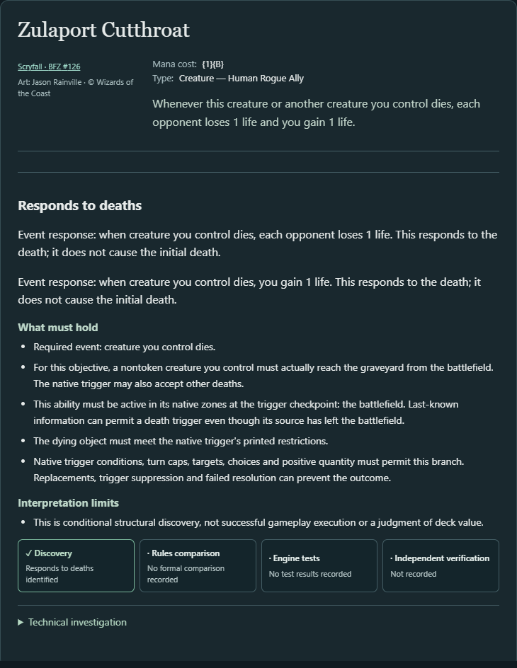
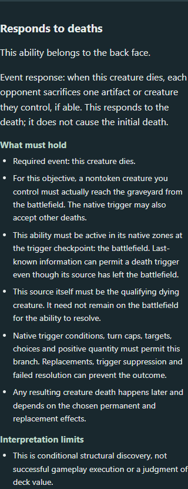

# Triggered operations in Discover

Launch `.\scripts\explorer.ps1` and open the local address it prints. In Discover, run **My nontoken creatures die** for **Judith, the Scourge Diva** and select **Responds to deaths**. Inspect Zulaport Cutthroat for two life operations on one trigger and Pyretic Prankster for the sacrifice on its transformed face.

1. **Shared interpretation.** The walker connects the incoming event and its native binding, zones and restrictions to the exact action and operation path. The record includes native operands, affected-player binding, quantity, prerequisites and uncertainty. An event query evaluates its requirements against that record.
2. **Operation coverage.** Fixed forced sacrifice, direct life loss and gain, and bounded direct player damage join draw and token creation. Damage has its own native source, amount and target. Coupled life drain and unresolved dynamic amounts remain outside this coverage.
3. **Outcome neutrality.** Zulaport's opponent life loss and controller life gain are two records on one action. Deathcurse Ogre's instruction affects every player, including its controller. Pyretic's opposing sacrifice qualifies through the same requirements as those effects.
4. **Event order.** A self-entry or death event can trigger an instruction. A sacrifice subsequently moves an eligible permanent if one is available, and a creature dies only if it reaches a graveyard from the battlefield. The shared record retains the triggering event, the instruction and the prerequisites for that later possibility.
5. **Another anchor.** Fleshbag Marauder's self-entry causes each player to sacrifice a creature. The same operation query accepts a creature-entry requirement and rejects the death requirement. A synthetic entry trigger with direct life loss exercises the same path.
6. **Reuse.** The forced-sacrifice records reference the existing battlefield sacrifice fact by ID. Gravelighter's false branch links to that same fact and now also links to the entry-triggered sacrifice record. Its death-history decision remains supported and the guarded event outcome retains UNKNOWN. Viscera Seer's activation cost has no triggered operation link.
7. **Controls.** Pyretic Prankster's Glistening Goremonger face is the native death-triggered sacrifice demonstration. Blood Artist preserves a chosen player. The Serpent Society retains its deathtouch prerequisite, and Lord Xander retains its dynamic quantity as unresolved. Midnight Reaper and the prior draw/Treasure controls preserve their native distinctions. The candidate CLI returned `Card not found` for Grave Pact. Its frozen source record and the synthetic opponent-sacrifice subset remain available. [Frozen source expectations](../src/test/resources/regression/triggered-operation-sources.json)
8. **Discover changes.** See the controlled counts and [comparison receipt](evidence/triggered-operation-comparison.json).
9. **Preservation.** Prior pathway verdicts remain in the comparison. Thought-Knot Seer's draw retains its legacy policy NO_MATCH, now recorded separately from its mechanical MATCH. Gravelighter's event-producing compatibility and the legacy removal projection keep their existing admission. History reports retain their predicates and verdicts while adding operation links.
10. **Admission implications.** The new records expose mandatory effects that harm the controller or affect all players. That broadens the mechanically relevant options and makes player scope important in the explanation. Product Studio's deferral of further discretionary exclusions leaves these as normal Discover findings. Mixed targets and unresolved quantities show where additional interpretation is needed.
11. **Verification scope.** Structural checks cover event binding, recipients, facts, optionality and branch confidence. Native scenarios observe the entry-to-sacrifice-to-death sequence and Zulaport's changes to both life totals, and the self-death scenario observes Deathcurse Ogre reducing both totals. The application captures show normal Discover results. Independent source and execution qualification retains its separate review process.
12. **Next increment.** Add reusable player-binding and last-known-information support for trigger restrictions on the dying object, beginning with a keyword requirement such as The Serpent Society's deathtouch check. Verify the same controller and object restriction on entry and death before broadening production admission.

## Controlled catalog comparisons

The values below are distinct cards / pathways. A card can appear in several verdict groups or operation families.

| Commander | Eligible | Death MATCH before → after | UNKNOWN before → after | NO_MATCH before → after | Cards gaining their first MATCH |
| --- | ---: | ---: | ---: | ---: | ---: |
| Judith, the Scourge Diva | 6,111 | 551 / 566 → 585 / 620 | 467 / 508 → 509 / 577 | 1,904 / 2,320 → 1,906 / 2,328 | 34 |
| Krenko, Mob Boss | 3,472 | 220 / 225 → 228 / 233 | 207 / 223 → 223 / 247 | 1,113 / 1,386 → 1,113 / 1,387 | 8 |
| Kenrith, the Returned King | 15,955 | 946 / 975 → 993 / 1,050 | 1,059 / 1,173 → 1,120 / 1,274 | 3,164 / 3,762 → 3,166 / 3,770 | 47 |

| New supported response pathways | Judith | Krenko | Kenrith |
| --- | ---: | ---: | ---: |
| Forced sacrifice | 1 | 0 | 1 |
| Direct life loss | 26 | 0 | 29 |
| Direct life gain | 18 | 4 | 36 |
| Direct player damage | 9 | 4 | 9 |
| Total | 54 | 8 | 75 |

The comparison checks exact structured equality for eligibility, native actions and mechanical facts, and preserves every prior draw/token record and pathway verdict. The other objectives retain their admissions. Their reports can gain shared event operations and updated support metadata for directly interpreted life changes. The receipt also lists the added UNKNOWN and NO_MATCH rows by action and path.

## Reproduction

- Live application baseline `14e62039e0f1054e0fba3dbd07db81823eff22f6` has the same runtime sources as `84875141525689702fa00cc81eeaad8414329ea9`. The retained PR #51 CLI reports supply the unchanged eligibility baselines. Argentum is `bd26b756b8b4d347f19e92bc77ef020919ebfa48`.
- Export `mtg-assistant discover --commander "<name>" --objective <id> --json --output <path>` for each Judith and Krenko objective and for Kenrith's death and history objectives. Run `python scripts/compare-triggered-operations.py <legacy-baseline-dir> <history-baseline-dir> <candidate-dir> docs/evidence/triggered-operation-comparison.json`.
- CLI exports, the browser backend and the standalone catalog audit use the application runtime at `98c4ef489ab92d2fdff8c56630b3360394c460f0`. The first full run was interrupted to correct a test's use of the SDK's card-predicate field for deathtouch. The next run passed the seven new checks and surfaced two superseded live coverage assertions. The final tests at `20f0773b2fadf32b41a813408861f8fe8e05c2de` preserve Blood Artist's creature-removal exclusion and Tannuk's unresolved gated draw while checking their additional event operation records. The frozen source and benchmark files retain their original content.
- The final frontend is `96024c82ba271d25eb670f7aa459357d25a72b4c`. `pnpm install --frozen-lockfile` and `pnpm build` passed. Six Edge checks passed against the running Kotlin application with `pnpm exec playwright test triggered-operations.spec.ts event-outcomes.spec.ts state-dependency.spec.ts creature-inputs.spec.ts`. The two new viewport checks covered forced sacrifice, direct life gain/loss, self-affecting loss, distinct player damage and the shared trigger explanation.
- `./dev.ps1 installDist` and `bash scripts/verify.sh catalog` passed. The current catalog gate recorded zero confirmed benchmark mismatches and an empty identical-report diff. The older historical fingerprints still differ, as in PR #51. The separate 12-report comparison uses the live baseline rather than that older fingerprint set.
- The final complete application run, `./dev.ps1 test --rerun`, passed **685 tests with zero failures, errors or skips**. It includes five new structural tests, two native execution scenarios and all-objective HTTP/CLI agreement.
